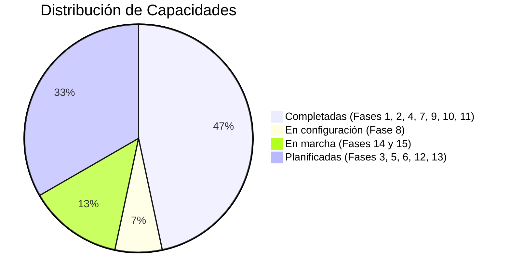
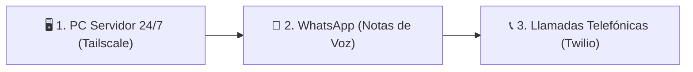

# 🎛️ Centro de Mando: E.D.I.T.H.

> [!quote] "Even Dead, I'm The Hero" - Enhanced Dialectical Intelligence & Tactical Heuristics

Bienvenido a tu centro de control en **Obsidian**. Desde aquí puedes monitorear el estado de EDITH, sus notas de arquitectura, su diario de reflexiones y el progreso hacia su autonomía total.

---

## 🧭 Navegación Rápida

| Sección                      | Nota Principal                                                        | Descripción                                      |
| ---------------------------- | --------------------------------------------------------------------- | ------------------------------------------------ |
| 🧭 **Roadmap Maestro**       | [[Plan de Cambios y Evolución de EDITH]]                              | Plan de 15 fases tácticas de desarrollo          |
| 📦 **App de escritorio**     | [[Diseño de EDITH Setup (Aplicación de Escritorio)]]                  | Instalador `EDITH-Setup.exe` y app nativa        |
| ⚙️ **Configurar canales**    | [[Guía de Configuración de Canales (WhatsApp, Teléfono y Heartbeat)]] | Activar WhatsApp, llamadas y Heartbeat           |
| 🛡️ **Seguridad**            | [[Auditoria de Seguridad y Protecciones de EDITH]]                    | Riesgos, mitigaciones y Fase 14                  |
| 🖥️ **Servidor & Teléfono**  | [[Arquitectura Servidor 24-7 y Comunicaciones (WhatsApp y Telefono)]] | Blueprint de PC 24/7, WhatsApp y llamadas VoIP   |
| 📜 **Bitácora de Versiones** | [[Registro de Cambios de EDITH]]                                      | Historial técnico de commits, benchmarks y fixes |
| 📓 **Diario de Charlas**     | `01 - Diario/`                                                        | Conversaciones archivadas automáticamente        |
| 🧠 **Conocimiento Atómico**  | `03 - Conocimiento/`                                                  | Notas y mapas conceptuales generados por EDITH   |
| 🧩 **Heurísticas y Memoria** | `04 - Memoria EDITH/`                                                 | Reglas aprendidas y auto-corrección de errores   |

---

## ⚡ Estado Actual del Sistema (v0.0.5)

- **Motor IA**: `qwen3:4b-instruct` (modo rápido ~1 s) / `qwen3:4b Thinking` (modo profundo).
- **Voz**: Neural `edge-tts` (Elvira, Dalia, Ximena, Salomé) + SAPI5 offline de respaldo.
- **Sentidos**: Screen Vision (captura completa y ventana) + LaTeX KaTeX + Highlight.js.
- **Almacenamiento**: Bóveda Obsidian `EDITH_p` con auto-sync en tiempo real.
- **Canales (v0.0.5)**: WhatsApp con notas de voz, llamadas Twilio (falta URL pública) y Heartbeat con recordatorios, alarmas y resumen matutino.

---

## 🎯 Próximos 3 Grandes Objetivos

1. **🖥️ Home Server en PC de Escritorio**:
   - Dejar de depender de la batería de la laptop.
   - Acceso remoto cifrado mediante malla Tailscale desde cualquier lugar.
2. **💬 WhatsApp Táctico**:
   - Enviar y recibir notas de voz sintetizadas con la voz de EDITH directamente en tu WhatsApp.
   - Recordatorios y alertas proactivas a tu celular.
3. **📞 Telefonía en Tiempo Real**:
   - Llamar a EDITH por teléfono o que ella te llame para urgencias y alarmas críticas.

---
*Centro de Mando actualizado automáticamente por E.D.I.T.H. - 15/10/2026.*