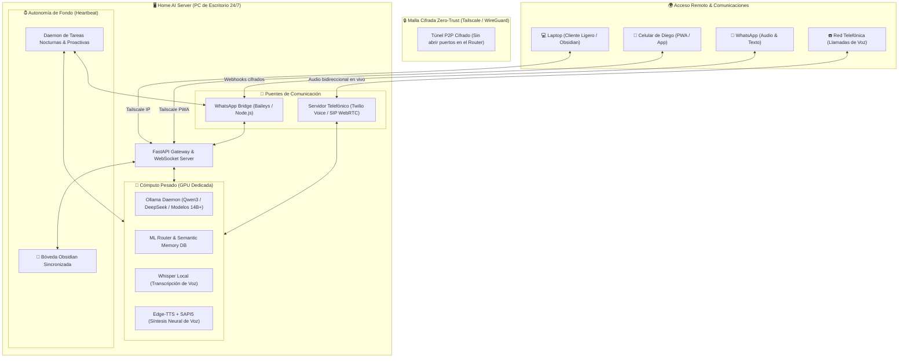
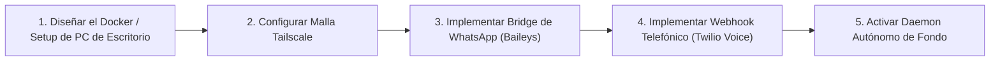

# 🖥️ E.D.I.T.H. 24/7: Servidor Central & Comunicaciones Ubicuas

> [!abstract] Visión del Proyecto
> Transformar a **E.D.I.T.H.** de una aplicación local atada a la batería y suspensión de una laptop en un **ente vivo y permanente**: un núcleo de inteligencia artificial que reside en una **PC de escritorio dedicada (Home AI Server)**, funcionando las 24 horas del día, los 7 días de la semana, accesible de forma segura desde tu laptop, tu celular, por **WhatsApp** y mediante **llamadas telefónicas de voz en tiempo real**.

---

## 🗺️ Diagrama Maestro de Arquitectura



---

## 🖥️ Pilar 1: La PC de Escritorio como Hogar Permanente (24/7 Server)

### ¿Por qué mudar el cerebro a una PC de escritorio?
1. **Potencia Térmica y GPU sin Restricciones**:
   - En la laptop, el consumo energético, la temperatura y los 6 GB de VRAM limitan el modelo.
   - En una PC de escritorio, puedes contar con GPUs de 12 GB, 16 GB o 24 GB de VRAM (ej. RTX 3060 12GB, RTX 4070, RTX 3090), permitiendo correr modelos mucho más densos (`deepseek-r1:14b`, `qwen2.5:14b` o `llama3.3:70b` cuantizado) a máxima velocidad.
2. **EDITH Nunca Duerme**:
   - Cuando cierras la laptop o te vas a dormir, la PC de escritorio sigue encendida. EDITH puede procesar memorias, organizar tus notas en Obsidian, leer la web, indexar información y preparar tu jornada para la mañana siguiente.
3. **Laptop Ligera & Batería Infinita**:
   - La laptop ya no ejecuta la IA localmente; solo abre la interfaz gráfica de EDITH (o el navegador) conectada a la PC de escritorio. Tu laptop se mantendrá fría, silenciosa y con la máxima duración de batería.

### Infraestructura de Red: Malla Segura con Tailscale
> [!tip] Conexión Segura sin Abrir Puertos
> No necesitas configurar routers ni exponer tu IP pública a internet.
- Se instala **Tailscale** en la PC de escritorio, en tu laptop y en tu teléfono.
- Los 3 dispositivos se comunican en una red privada virtual cifrada (WireGuard).
- Accedes a EDITH desde cualquier red Wi-Fi o con datos móviles 5G marcando su IP fija privada (ej. `http://100.x.y.z:8000`).

---

## 💬 Pilar 2: WhatsApp Táctico (Tu Asistente en el Bolsillo)

### Capacidades:
- **Mensajería Directa**: Hablas con EDITH desde un chat privado en tu WhatsApp exactamente como si fuera un contacto humano.
- **Notas de Voz Bidireccionales**:
  1. Le mandas un audio de WhatsApp mientras vas caminando o conduciendo.
  2. El servidor lo recibe, lo transcribe en segundos con `faster-whisper` local.
  3. EDITH razona, redacta la solución y la sintetiza con su voz neural (`edge-tts`).
  4. Recibes en tu WhatsApp una **nota de voz de EDITH respondiéndote**.
- **Alertas y Notificaciones Proactivas**:
  - *"Diego, detecté que tu laptop lleva 4 horas con uso intensivo de CPU."*
  - *"Buenos días Diego, hoy tienes 3 tareas programadas en tu diario de Obsidian. Aquí tienes tu resumen matutino."*

### Implementación Técnica:
- **Módulo Bridge (Baileys / Node.js o WPPConnect)**: Corre como servicio en la PC de escritorio. Se escanea un código QR una sola vez y queda enlazado.
- Webhook interno conectado al `FastAPI Gateway` de EDITH.

---

## 📞 Pilar 3: Llamadas Telefónicas de Voz en Tiempo Real

### Capacidades:
1. **Llamadas Entrantes (Tú llamas a EDITH)**:
   - Marcas un número telefónico asignado a tu servidor desde cualquier teléfono.
   - EDITH contesta: *"Hola Diego, dime qué necesitas"*.
   - Hablan en tiempo real con baja latencia. Puedes pedirle que consulte tus notas de Obsidian, que ejecute un script o que te resuma un tema.
2. **Llamadas Salientes (EDITH te llama a ti)**:
   - **Despertador Táctico / Urgencias**: Si configuras una alarma o recordatorio crítico y no respondes en WhatsApp, EDITH hace sonar tu teléfono.
   - Al descolgar, te habla: *"Diego, son las 7:00 AM. Recuerda que a las 8:30 tienes la presentación."*
3. **Llamadas Delegadas**:
   - Pedirle a EDITH: *"Llama al restaurante X y pregunta qué horario tienen hoy"*.

### Implementación Técnica:
- **Twilio Voice API / SIP Trunk**: Proveedor que conecta la red telefónica con el servidor mediante WebSockets de streaming de audio.
- **Pipeline de Audio en Tiempo Real**:
  ```text
  Llamada Telefónica (PCM Audio) → WebSocket → Whisper STT (Streaming) → Qwen3 LLM → Edge-TTS / Kokoro → WebSocket → Teléfono de Diego
  ```

---

## 🚀 Pilar 4: ¿Qué Más le Falta a EDITH? (Diagnóstico de Evolución Total)

Además del Servidor 24/7, WhatsApp y Telefonía, estas son las **4 grandes fronteras** que completarán el sistema definitivo:

### 1. ⏰ Autonomía Proactiva (Heartbeat Daemon)
- **Problema actual**: EDITH es 100 % *reactiva* (solo hace algo si tú le hablas).
- **Evolución**: Un hilo de fondo en el servidor que se despierta cada 15-30 minutos:
  - Revisa tu Google Calendar / Outlook y tus notas de Obsidian.
  - Verifica las noticias del día sobre tecnología e IA.
  - Detecta si dejaste tareas pendientes y te propone soluciones de forma proactiva.

### 2. 👁️ Ojos en el Mundo Real (Visión por Webcam / RTSP)
- **Problema actual**: Tiene `Screen Vision` (ve la pantalla de la laptop), pero no puede ver el mundo físico.
- **Evolución**: Conexión con la webcam de la PC o cámaras del cuarto:
  - Reconocimiento facial: *"Hola Diego, te veo cansado hoy, ¿quieres que pongamos música relajante?"*
  - Análisis de objetos: sostener un circuito, un papel con fórmulas o un libro frente a la cámara y pedirle que lo explique.

### 3. 🌐 Navegación Autónoma de Internet (*Browser Computer Use*)
- **Problema actual**: Hoy solo busca en DuckDuckGo y lee texto estático HTML.
- **Evolución**: Integración con **Playwright / Browser-Use**:
  - EDITH puede abrir un navegador Chromium real, iniciar sesión en portales, rellenar formularios, descargar facturas, comparar precios y comprar productos cuando se lo autorices.

### 4. 🏠 Domótica & Control del Entorno (Home Assistant)
- Al vivir en la PC de tu casa/habitación, integración con **Home Assistant**:
  - Control de luces ("EDITH, modo trabajo" / "EDITH, hora de dormir").
  - Monitoreo de temperatura y consumo eléctrico.

---

## 🗺️ Plan de Ejecución Inmediato



---
*Documento maestro de arquitectura generado e indexado en Obsidian para E.D.I.T.H. - 15 de Octubre, 2026.*