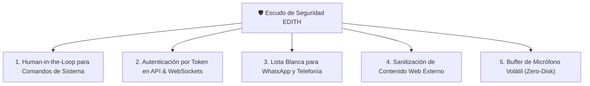

# 🛡️ Auditoría de Seguridad y Endurecimiento de E.D.I.T.H.

> [!abstract] Resumen Ejecutivo
> Se realizó una **auditoría estática y dinámica de ciberseguridad** sobre la arquitectura actual de EDITH (v0.0.4 / v0.0.5). El sistema cuenta con excelentes defensas contra *Path Traversal*, pero presenta **vulnerabilidades críticas que deben resolverse antes de migrarla a un Servidor 24/7 o conectarla a WhatsApp y Telefonía**.
>
> **Actualización v0.0.7 (16/10/2026):** los dos riesgos críticos y el de inyección indirecta quedaron **mitigados** (token de acceso + `Host`/`Origin`, confirmación humana, contenido externo marcado y HTML saneado). Queda pendiente el riesgo medio de secretos en texto plano (DPAPI).

---

## 📊 Matriz de Evaluación de Riesgos

| Vector de Ataque | Riesgo | Estado Actual | Impacto Potencial | Mitigación Requerida |
|---|---|---|---|---|
| **1. Inyección de Comandos PowerShell** | 🟢 **MITIGADO (v0.0.7)** | Cada comando y cada app piden «¿Autorizas?» en pantalla; sin respuesta en 120 s se rechaza; desde remoto se rechaza; `open_application` sin `shell=True` | Ejecución arbitraria de scripts / borrado (antes) | Mantener las pruebas de `tests/test_seguridad.py` |
| **2. Falta de Autenticación en API / WS** | 🟢 **MITIGADO (v0.0.7)** | Token obligatorio (cookie `HttpOnly` o `Bearer`), `Host` permitido y `Origin` del mismo sitio | Control remoto no autorizado en servidor (antes) | En red: `EDITH_ALLOWED_HOSTS` + enlace de `--access-link` |
| **3. Inyección Indirecta de Prompts** | 🟢 **MITIGADO (v0.0.7)** | Web, archivos y notas llegan como `[DATO NO CONFIABLE]`; tras leerlos, las acciones sensibles piden confirmación y, tras leer datos privados, salir a internet también | La IA ejecuta órdenes ocultas de webs (antes) | Un modelo pequeño puede seguir equivocándose: la confirmación es la barrera real |
| **4. Fuga de Secretos & Credenciales** | 🟡 **MEDIO** | `.env` y `data.json` en texto plano | Exposición de API keys y sesión WhatsApp | Cifrado DPAPI / Permisos `icacls` |
| **5. Privacidad de Audio (Hot-Mic)** | 🟢 **BAJO** | Pendiente implementación nativa | Grabación inadvertida de voz | Buffer solo en RAM, sin guardado en disco |
| **6. Path Traversal en Workspace** | 🟢 **CORREGIDO (v0.0.5)** | Tenía un fallo de prefijo (`startswith`) que dejaba escribir en carpetas hermanas; ahora compara por componentes de ruta | Escritura fuera de `workspace/` (antes) | Mantener la prueba de regresión |
| **7. Canales remotos (WhatsApp/Teléfono)** | 🟢 **MITIGADO (v0.0.5)** | Lista blanca, firma de Twilio, clave del bridge, sin herramientas de sistema desde remoto | Control de la PC por un tercero | Mantener `REMOTE_ALLOW_SYSTEM_TOOLS=false` |
| **8. HTML del modelo en la interfaz (XSS)** | 🟢 **MITIGADO (v0.0.7)** | DOMPurify 3.4.16 (versión fija + SRI); imágenes externas, `<style>`, formularios y CSS peligroso bloqueados; fuentes y diagramas escapados | Robar la sesión o pulsar «Autorizar» por ti | Falta una CSP completa |
| **9. Conversaciones en el repositorio** | 🟢 **CORREGIDO (v0.0.7)** | `data/sessions/` fuera de git | Publicar tus charlas al subir el código | `data/memory/` y `data/audio/` siguen en git |
| **10. Claves de plugins de Obsidian en GitHub** | 🟠 **ALTO → contenido (v0.0.8)** | `.obsidian/plugins/*/data.json` fuera de git y en `.gitignore` | El commit `7446bb0` publicó la API key y las claves privadas de los certificados del plugin Local REST API en el repositorio público | **Regenerarlas en Obsidian**; borrar del historial requiere reescribirlo |
| **11. Ajustes desde la interfaz** | 🟢 **PROTEGIDO (v0.0.8)** | Token + solo esta computadora + mismo `Origin`; una línea por ajuste y solo claves conocidas | Que otra web o dispositivo cambie modelos, números autorizados o active PowerShell remoto | — |

---

## 🔍 Análisis Detallado de Vulnerabilidades

### 🔴 1. Inyección de Comandos en `run_system_command`
- **Ubicación**: `agent/tools/system_tools.py`
- **Diagnóstico**:
  ```python
  # Filtro actual:
  dangerous_keywords = ["format ", "del /f /s /q c:", "rmdir /s /q c:\\windows", "bcdedit"]
  ```
  Este filtro por lista negra es fácilmente eludible. Comandos como:
  `Remove-Item -Recurse -Force C:\Users\diego\Documents`
  o descargas remotas `Invoke-WebRequest` no contienen esas palabras clave y se ejecutarían sin restricción.
- **Riesgo**: Si un sitio web malicioso contiene instrucciones ocultas para el agente (*Indirect Prompt Injection*), el modelo podría ejecutar comandos dañinos creyendo que cumple una orden del usuario.
- **Solución Propuesta**:
  - Implementar **Human-in-the-loop (Aprobación Obligatoria)**: la interfaz gráfica debe mostrar un modal modal flotante: *"EDITH solicita ejecutar: `[comando]`. ¿Autorizas la ejecución? [Sí] [No]"*.

> [!success] Implementado (v0.0.7)
> - Modal **«EDITH quiere ejecutar: … ¿Autorizas?»** con el comando exacto; el foco empieza en *Rechazar*, `Esc` rechaza y sin respuesta se rechaza sola a los 120 s. El agente espera la respuesta por el WebSocket y solo la pestaña que hizo la pregunta puede contestarla.
> - En la terminal, `¿Autorizas? [y/n]`. Desde WhatsApp/teléfono no hay a quién preguntar: se rechaza.
> - `open_application` ya no usa `shell=True` (antes `"notepad & del archivo"` también borraba). La lista negra de `run_system_command` se mantiene como capa extra, pero la barrera es la confirmación.

---

### 🔴 2. Exposición de API sin Autenticación (Peligro en Servidor 24/7)
- **Ubicación**: `ide/server.py`
- **Diagnóstico**:
  Los endpoints `/api/*` y el WebSocket `/ws/chat` no requieren ninguna clave ni token.
  - En tu laptop con `localhost:8000` el riesgo es bajo.
  - **En la PC Servidor 24/7 conectada a red local o Tailscale**: Cualquier dispositivo en tu red Wi-Fi (o quien tenga acceso a la IP) puede controlar la PC, leer tus notas privadas de Obsidian, borrar archivos o consultar tus sesiones sin contraseña.
- **Solución Propuesta**:
  - Middleware de autenticación con `EDITH_API_TOKEN` en variables de entorno.
  - Validación de encabezado `Authorization: Bearer <TOKEN>` y parámetro `?token=<TOKEN>` para WebSockets.
  - Rate Limiting (máximo 60 peticiones/minuto) para evitar saturación de la GPU.

> [!success] Implementado (v0.0.7) — `ide/auth.py`
> - Token en `EDITH_API_TOKEN` o `%LOCALAPPDATA%\EDITH\data\channels\api_token` (se genera solo). Se acepta en cookie `HttpOnly` + `SameSite=Lax` o `Authorization: Bearer`; **no** en la URL salvo el enlace de entrada, que lo cambia por la cookie y redirige sin él.
> - En la propia máquina (127.0.0.1, sin proxy delante) la interfaz entra sola; por un túnel nunca.
> - `Host` permitido siempre (bloquea *DNS rebinding*) y `Origin` del mismo sitio en el WebSocket y en `POST`/`PATCH`/`DELETE` (bloquea CSRF, también desde otras webs en `localhost`).
> - Bridge de WhatsApp, webhooks de Twilio y `/ws/voice` mantienen su propia autenticación.
> - Pendiente: el límite de peticiones por minuto.

---

### 🟡 3. Seguridad en el Bridge de WhatsApp y Telefonía
- **Diagnóstico**:
  Al conectar WhatsApp y llamadas telefónicas, terceros podrían intentar comunicarse con el número de EDITH.
- **Solución Propuesta**:
  - **Lista blanca estricta de números telefónicos**: EDITH solo responderá a tu número celular personal (`AUTHORIZED_PHONE_NUMBERS = ["+52..."]`).
  - Cualquier mensaje o llamada de un número desconocido recibirá un rechazo educado y no tendrá acceso a herramientas ni notas de Obsidian.

---

### 🟢 4. Inyección indirecta de prompts (MITIGADO en v0.0.7)
- **Ubicación**: `agent/core/safety.py` y `agent/core/reasoning_agent.py`.
- La salida de `web_search`, `read_web_page`, archivos, notas de Obsidian, portapapeles y pantalla llega al modelo como `[DATO NO CONFIABLE · origen: …]` entre `<<<CONTENIDO_EXTERNO>>>` y `<<<FIN_CONTENIDO_EXTERNO>>>`; el texto no puede cerrar el bloque por su cuenta.
- En un turno con contenido externo, guardar archivos, escribir en Obsidian, recordatorios, portapapeles, volumen y pantalla piden confirmación. Tras leer datos privados, también consultar internet (evita que una instrucción escondida saque tus notas en una URL).
- En la interfaz, DOMPurify sanea cada respuesta y las imágenes externas no se cargan solas (otra vía de filtración).

---

### 🟢 5. Análisis de Path Traversal (Resultado: CORREGIDO en v0.0.5)
- **Ubicación**: `agent/tools/workspace_tools.py` y `agent/tools/obsidian_tools.py`
- **Diagnóstico**:
  Se verificó el uso de `.resolve()` y verificación de pertenencia a la carpeta raíz:
  ```python
  if not str(resolved).startswith(str(WORKSPACE_DIR.resolve())):
      raise ValueError("Acceso denegado: intento de salida del directorio workspace.")
  ```
  No es posible acceder a archivos del sistema como `Windows/System32` mediante secuencias `../../`.

  > [!bug] Corrección (v0.0.5)
  > La comprobación por prefijo de texto sí tenía un hueco: `../workspace_x/archivo` se resuelve a `…/workspace_x/archivo`, que **empieza por** `…/workspace` y pasaba el filtro. Se cambió a una comparación por componentes de ruta (`root in resolved.parents`) y hay una prueba que lo verifica.

---

## 🛡️ Plan de Endurecimiento Táctico (Fase 14)



### Medidas a Implementar:
1. [x] **Token de Seguridad `EDITH_API_TOKEN`**: cookie `HttpOnly` o Bearer, más `Host` y `Origin`, en `ide/auth.py` (v0.0.7).
2. [x] **Modal de Confirmación para Acciones Críticas**: Ningún comando de terminal se ejecuta a ciegas (v0.0.7).
3. [x] **Filtro de Números Autorizados**: lista blanca obligatoria para WhatsApp y Twilio (v0.0.5).
4. [x] **Aislamiento de Prompts de Búsqueda Web**: texto externo marcado como `[DATO NO CONFIABLE]` y acciones sensibles con confirmación (v0.0.7).
5. [x] **HTML saneado con DOMPurify** y conversaciones fuera de git (v0.0.7).
6. [ ] **Límite de peticiones** (60/min) para no saturar la GPU.
7. [ ] **Secretos cifrados con DPAPI** (`.env`, clave del bridge, token, sesión de WhatsApp).
8. [ ] **Content-Security-Policy completa** y versiones fijas de todas las librerías del CDN.
9. [ ] **Buffer de micrófono volátil** (Fase 3).
10. [ ] **Regenerar la API key y los certificados del plugin Local REST API** de Obsidian (publicados en `7446bb0`).

### 🔐 Entrar desde otro dispositivo (cuando EDITH esté en el servidor)
1. En el servidor, añade a `.env` el nombre o la IP con que llegas (p. ej. `EDITH_ALLOWED_HOSTS=edith-pc,100.101.102.103`).
2. Ejecuta `python main.py --access-link` y abre el enlace en el celular o la laptop (una vez por dispositivo; dura 30 días y se renueva al usarla).
3. El enlace contiene el token: no lo compartas. Para revocar todos los accesos, borra `data/channels/api_token` y reinicia EDITH.
4. Las pruebas de todo esto: `python tests/test_seguridad.py` (78 casos).

---
*Auditoría de ciberseguridad realizada e indexada en Obsidian para E.D.I.T.H. - 15/10/2026. Actualizada el 16/10/2026 (v0.0.8).*