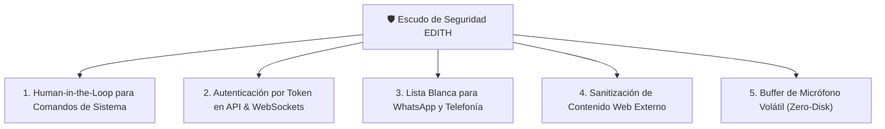

# 🛡️ Auditoría de Seguridad y Endurecimiento de E.D.I.T.H.

> [!abstract] Resumen Ejecutivo
> Se realizó una **auditoría estática y dinámica de ciberseguridad** sobre la arquitectura actual de EDITH (v0.0.4 / v0.0.5). El sistema cuenta con excelentes defensas contra *Path Traversal*, pero presenta **vulnerabilidades críticas que deben resolverse antes de migrarla a un Servidor 24/7 o conectarla a WhatsApp y Telefonía**.

---

## 📊 Matriz de Evaluación de Riesgos

| Vector de Ataque | Riesgo | Estado Actual | Impacto Potencial | Mitigación Requerida |
|---|---|---|---|---|
| **1. Inyección de Comandos PowerShell** | 🔴 **CRÍTICO** | Lista negra básica (4 palabras) | Ejecución arbitraria de scripts / borrado | Confirmación humana (*Human-in-the-Loop*) |
| **2. Falta de Autenticación en API / WS** | 🔴 **CRÍTICO** (en red) | Sin auth (diseñado para localhost) | Control remoto no autorizado en servidor | Token Bearer / API Key obligatorio |
| **3. Inyección Indirecta de Prompts** | 🟡 **MEDIO** | Datos web entran directo al LLM | La IA ejecuta órdenes ocultas de webs | Sanitización de contexto no confiable |
| **4. Fuga de Secretos & Credenciales** | 🟡 **MEDIO** | `.env` y `data.json` en texto plano | Exposición de API keys y sesión WhatsApp | Cifrado DPAPI / Permisos `icacls` |
| **5. Privacidad de Audio (Hot-Mic)** | 🟢 **BAJO** | Pendiente implementación nativa | Grabación inadvertida de voz | Buffer solo en RAM, sin guardado en disco |
| **6. Path Traversal en Workspace** | 🟢 **CORREGIDO (v0.0.5)** | Tenía un fallo de prefijo (`startswith`) que dejaba escribir en carpetas hermanas; ahora compara por componentes de ruta | Escritura fuera de `workspace/` (antes) | Mantener la prueba de regresión |
| **7. Canales remotos (WhatsApp/Teléfono)** | 🟢 **MITIGADO (v0.0.5)** | Lista blanca, firma de Twilio, clave del bridge, sin herramientas de sistema desde remoto | Control de la PC por un tercero | Mantener `REMOTE_ALLOW_SYSTEM_TOOLS=false` |

---

## 🔍 Análisis Detallado de Vulnerabilidades

### 🔴 1. Inyección de Comandos en `run_system_command`
- **Ubicación**: `agent/tools/system_tools.py`
- **Diagnóstico**:
  ```python
  # Filtro actual:
  dangerous_keywords = ["format ", "del /f /s /q c:", "rmdir /s /q c:\\windows", "bcdedit"]
  ```
  Este filtro por lista negra es fácilmente eludible. Comandos como:
  `Remove-Item -Recurse -Force C:\Users\diego\Documents`
  o descargas remotas `Invoke-WebRequest` no contienen esas palabras clave y se ejecutarían sin restricción.
- **Riesgo**: Si un sitio web malicioso contiene instrucciones ocultas para el agente (*Indirect Prompt Injection*), el modelo podría ejecutar comandos dañinos creyendo que cumple una orden del usuario.
- **Solución Propuesta**:
  - Implementar **Human-in-the-loop (Aprobación Obligatoria)**: la interfaz gráfica debe mostrar un modal modal flotante: *"EDITH solicita ejecutar: `[comando]`. ¿Autorizas la ejecución? [Sí] [No]"*.

---

### 🔴 2. Exposición de API sin Autenticación (Peligro en Servidor 24/7)
- **Ubicación**: `ide/server.py`
- **Diagnóstico**:
  Los endpoints `/api/*` y el WebSocket `/ws/chat` no requieren ninguna clave ni token.
  - En tu laptop con `localhost:8000` el riesgo es bajo.
  - **En la PC Servidor 24/7 conectada a red local o Tailscale**: Cualquier dispositivo en tu red Wi-Fi (o quien tenga acceso a la IP) puede controlar la PC, leer tus notas privadas de Obsidian, borrar archivos o consultar tus sesiones sin contraseña.
- **Solución Propuesta**:
  - Middleware de autenticación con `EDITH_API_TOKEN` en variables de entorno.
  - Validación de encabezado `Authorization: Bearer <TOKEN>` y parámetro `?token=<TOKEN>` para WebSockets.
  - Rate Limiting (máximo 60 peticiones/minuto) para evitar saturación de la GPU.

---

### 🟡 3. Seguridad en el Bridge de WhatsApp y Telefonía
- **Diagnóstico**:
  Al conectar WhatsApp y llamadas telefónicas, terceros podrían intentar comunicarse con el número de EDITH.
- **Solución Propuesta**:
  - **Lista blanca estricta de números telefónicos**: EDITH solo responderá a tu número celular personal (`AUTHORIZED_PHONE_NUMBERS = ["+52..."]`).
  - Cualquier mensaje o llamada de un número desconocido recibirá un rechazo educado y no tendrá acceso a herramientas ni notas de Obsidian.

---

### 🟢 4. Análisis de Path Traversal (Resultado: CORREGIDO en v0.0.5)
- **Ubicación**: `agent/tools/workspace_tools.py` y `agent/tools/obsidian_tools.py`
- **Diagnóstico**:
  Se verificó el uso de `.resolve()` y verificación de pertenencia a la carpeta raíz:
  ```python
  if not str(resolved).startswith(str(WORKSPACE_DIR.resolve())):
      raise ValueError("Acceso denegado: intento de salida del directorio workspace.")
  ```
  No es posible acceder a archivos del sistema como `Windows/System32` mediante secuencias `../../`.

  > [!bug] Corrección (v0.0.5)
  > La comprobación por prefijo de texto sí tenía un hueco: `../workspace_x/archivo` se resuelve a `…/workspace_x/archivo`, que **empieza por** `…/workspace` y pasaba el filtro. Se cambió a una comparación por componentes de ruta (`root in resolved.parents`) y hay una prueba que lo verifica.

---

## 🛡️ Plan de Endurecimiento Táctico (Fase 14)



### Medidas a Implementar:
1. [ ] **Token de Seguridad `EDITH_API_KEY`**: Protección con Bearer token en `server.py`.
2. [ ] **Modal de Confirmación para Acciones Críticas**: Ningún comando de terminal se ejecutará a ciegas.
3. [x] **Filtro de Números Autorizados**: lista blanca obligatoria para WhatsApp y Twilio (v0.0.5).
4. [ ] **Aislamiento de Prompts de Búsqueda Web**: Marcar texto externo como `[Dato no verificado]` para que el LLM no ejecute instrucciones encontradas en internet.

---
*Auditoría de ciberseguridad realizada e indexada en Obsidian para E.D.I.T.H. - 15/10/2026.*