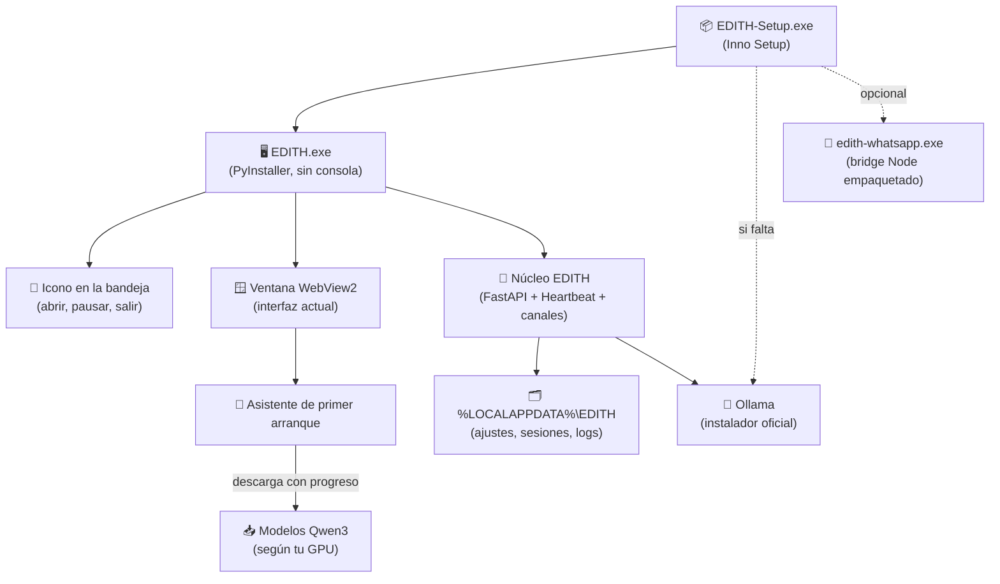
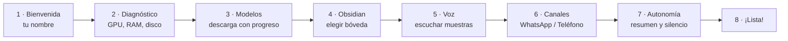

# 📦 EDITH Setup: de proyecto de carpeta a aplicación de escritorio

> [!abstract] Objetivo
> Que EDITH se instale con un único **`EDITH-Setup.exe`** —como Claude, ChatGPT o Discord— en cualquier PC con Windows, sin abrir terminales, sin instalar Python a mano y sin editar `.env`. Al terminar: icono en el escritorio y en el menú Inicio, ventana propia sin consola, icono junto al reloj y un asistente de primer arranque que deja todo configurado.
>
> Fase del plan: [[Plan de Cambios y Evolución de EDITH#📦 Fase 15: EDITH Setup — Aplicación de Escritorio Instalable|Fase 15]].

---

> [!success] Entrega 15.1 completada (v0.0.6, 16/10/2026)
> App nativa sin instalador: `EDITH.exe`, bandeja, cerrar = ocultar, instancia única, puerto libre, `%LOCALAPPDATA%\EDITH`, atajo global y avisos con identidad propia. Detalle en [[Registro de Cambios de EDITH#v0.0.6 — 16/10/2026 · EDITH como app de escritorio (Fase 15.1)]].

> [!success] Entrega 15.2 completada (v0.0.8, 16/10/2026)
> Asistente de primer arranque y panel ⚙️ Ajustes. Detalle en [[Registro de Cambios de EDITH#v0.0.8 — 16/10/2026 · Asistente de primer arranque y Ajustes (Fase 15.2)]].

> [!success] Entrega 15.3 completada (v0.0.9, 16/10/2026)
> Empaquetado: `build\build_setup.ps1` → `dist\EDITH\EDITH.exe` (PyInstaller, modo carpeta), que funciona sin la carpeta del proyecto ni el `.venv`, y `edith-whatsapp.exe` (esbuild + Node SEA). Detalle en [[Registro de Cambios de EDITH#v0.0.9 — 16/10/2026 · EDITH empaquetada, sin el proyecto ni el .venv (Fase 15.3)]].

## 🔎 Punto de partida (antes de la 15.1, v0.0.5)

| Pieza actual | Cómo funciona | Problema |
|---|---|---|
| `install_edith.bat` | Crea accesos directos que apuntan a `run_desktop.bat` | No instala nada: depende de que la carpeta del proyecto y el `.venv` existan |
| `run_desktop.bat` | Abre una **consola negra**, activa `.venv`, arranca Ollama y lanza `desktop/desktop_app.py` | Consola visible; si se cierra, EDITH muere; solo funciona en esta laptop |
| `desktop/desktop_app.py` | Ventana `pywebview` sobre `http://127.0.0.1:8000` | Puerto fijo (choca si 8000 está ocupado); cerrar la ventana apaga el Heartbeat y WhatsApp |
| `.env` | Toda la configuración | Hay que editarlo a mano |
| `data/` | Dentro de la carpeta del código | Una actualización podría pisar conversaciones; y `data/sessions` está en git |

Lo que **sí** sirve tal cual: la interfaz web (se reutiliza entera), `pywebview` y WebView2 (ya instalado en Windows 11; versión 155 en esta laptop).

---

## 🏗️ Arquitectura propuesta

### Decisiones técnicas

| Tema | Elección | Por qué | Alternativas descartadas |
|---|---|---|---|
| Ventana | **pywebview + WebView2** | Ya funciona, reutiliza la interfaz y no añade peso (WebView2 viene con Windows 11) | Electron (+150 MB y otro runtime), Tauri (reescribir el lanzador en Rust) |
| Empaquetado de Python | **PyInstaller, modo carpeta** (`--onedir`) | Arranca rápido y da menos falsos positivos de antivirus que `--onefile`; soporta Python 3.13 | Nuitka (compila más lento; valorar si el antivirus molesta) |
| Instalador | **Inno Setup** → `EDITH-Setup-x.y.z.exe` | Gratis, estándar en Windows, desinstalador y opciones incluidas | MSI/WiX (más complejo), MSIX (requiere firma) |
| Instalación | **Por usuario** en `%LOCALAPPDATA%\Programs\EDITH` | No pide permisos de administrador | `Program Files` (pide admin en cada actualización) |
| Datos del usuario | `%LOCALAPPDATA%\EDITH\` | Sobreviven a actualizaciones y desinstalaciones (si eliges conservarlos) | Junto al código (como hoy) |
| Configuración | `settings.json` editable desde la app; `.env` solo para desarrollo | Nadie edita archivos a mano | — |
| Modelos de IA | **No van dentro del instalador**: se descargan en el primer arranque | Pesan ~5 GB y dependen de tu GPU; el instalador queda en cientos de MB | Instalador de 6 GB |
| Bridge de WhatsApp | **Componente opcional**: `esbuild` + *Node Single Executable* → `edith-whatsapp.exe` | Quien no use WhatsApp no instala Node (~80 MB) | Exigir Node instalado |

---

## 🧙 Asistente de primer arranque

1. **Bienvenida**: nombre (alimenta la memoria a largo plazo) e idioma.
2. **Diagnóstico del equipo** con recomendación automática:

   | VRAM detectada | Modelo rápido | Modelo profundo |
   |---|---|---|
   | Sin GPU dedicada | `qwen3:1.7b` | `qwen3:4b` (lento) |
   | 6–8 GB (como esta laptop) | `qwen3:4b-instruct` | `qwen3:4b` |
   | 12–16 GB | `qwen3:8b` | `qwen3:14b` |
   | 24 GB o más | `qwen3:14b` | `qwen3:32b` |

   También comprueba **espacio en disco** antes de descargar (esta laptop tiene ~29 GB libres: suficiente, pero conviene avisar).
3. **Modelos**: descarga con barra de progreso (`/api/pull` de Ollama), reanudable si se corta internet.
4. **Obsidian**: selector de carpeta; crea la estructura `00 – 04` si la bóveda está vacía.
5. **Voz**: escuchar Elvira, Dalia, Ximena y Salomé y elegir.
6. **Canales (opcional)**: números autorizados, QR de WhatsApp y credenciales de Twilio. Se puede saltar.
7. **Autonomía**: hora del resumen matutino, horas de silencio, iniciar con Windows.
8. **Lista**: primera conversación de prueba.

Todo lo elegido queda editable en un panel **Ajustes** dentro de la app.

> [!note] Cómo quedó en la v0.0.8
> - **7 pasos** en vez de 8: diagnóstico y modelos van juntos (si los modelos ya están, no descarga nada) y el último paso es un resumen; la primera conversación es la propia ventana de chat. Sin selector de idioma: EDITH habla español.
> - La tabla de modelos tiene un escalón más: con **10–12 GB** usa `qwen3:8b` para los dos modos (es híbrido) y `qwen3:14b` como profundo solo desde 16 GB.
> - «Iniciar con Windows» está en el paso de *Iniciativa propia* y en Ajustes; arranca oculta en la bandeja (`--tray`).
> - «Configurar más tarde» cierra el asistente para siempre; todo queda en ⚙️ Ajustes (barra lateral y menú del icono junto al reloj).
> - Los ajustes se aplican sin reiniciar, salvo el puerto y el atajo global.

---

## 🪟 Comportamiento de app nativa

- **Sin consola**: `EDITH.exe` es una app de ventana; los registros van a `%LOCALAPPDATA%\EDITH\logs`.
- **Icono en la bandeja** (junto al reloj): *Abrir EDITH · Nueva conversación · Pausar avisos · Salir*.
- **Cerrar ≠ salir**: cerrar la ventana la oculta y EDITH sigue con el Heartbeat, WhatsApp y los recordatorios; *Salir* la apaga de verdad.
- **Una sola instancia**: abrir EDITH dos veces solo enfoca la ventana existente.
- **Puerto libre automático** en lugar del 8000 fijo.
- **Iniciar con Windows** (opcional, minimizada en la bandeja).
- **Notificaciones con identidad propia**: los avisos dirán "EDITH" con su logo (hoy aparecen como "Windows PowerShell").
- **Atajo global** `Win + Shift + E` para invocarla desde cualquier programa (absorbe la Fase 6).
- **Dos modos** de conexión:
  - *Todo en esta PC* (por defecto).
  - *Cliente de mi servidor EDITH* (Fase 8): la app solo abre la ventana hacia `https://tu-servidor` con su token. Requiere la autenticación de la Fase 14.

---

## 🔄 Actualizaciones, firma y desinstalación

- **Actualizaciones**: al arrancar, EDITH consulta un manifiesto de versiones (p. ej. *GitHub Releases*) y ofrece "Hay una versión nueva"; descarga el nuevo `EDITH-Setup` y lo ejecuta. Tus datos no se tocan.
- **Firma de código**: sin firmar, Windows mostrará *"Windows protegió tu PC"* (SmartScreen) al instalar. Opciones: aceptarlo para uso personal, un certificado autofirmado solo para tus equipos, o firma real (Azure Trusted Signing o certificado comercial) si se distribuye a otras personas.
- **Antivirus**: los ejecutables de PyInstaller a veces dan falsos positivos; el modo carpeta y la firma lo reducen.
- **Desinstalador**: pregunta si conservar conversaciones, recordatorios y ajustes.

---

## 🧱 Construcción

`build/build_setup.ps1` hará en un solo comando:
1. Crear un entorno limpio e instalar `requirements.txt` + PyInstaller.
2. `pyinstaller edith.spec` → `dist/EDITH/EDITH.exe`.
3. Empaquetar el bridge de WhatsApp (`esbuild` + Node SEA) → `edith-whatsapp.exe`.
4. Compilar `installer/edith.iss` con Inno Setup → `dist/EDITH-Setup-x.y.z.exe`.
5. Versión única en un archivo `VERSION` que leen la app, el instalador y el actualizador.

> [!note] Cómo quedó en la v0.0.9
> - Pasos 1, 2, 3 y 5 hechos; el 4 (Inno Setup) es la 15.4. El script termina con una **autocomprobación** (`EDITH.exe --self-test`, 11 comprobaciones sin abrir ventanas) y con `edith-whatsapp.exe --check`.
> - Tamaños medidos: `dist\EDITH` **401 MB** y `edith-whatsapp.exe` **97 MB**, sin comprimir.
> - La app empaquetada usa siempre `%LOCALAPPDATA%\EDITH\.env`. En esta laptop, la primera vez copia el `.env` del proyecto para no perder los ajustes.
> - `requirements.txt` no tenía `pystray` ni `Pillow`: el entorno limpio lo destapó.

**Pruebas**: instalar en una cuenta de Windows nueva o en una máquina virtual (Windows Sandbox no está disponible en Windows 11 *Home*). Verificar: instalación sin admin, asistente completo, Heartbeat con la ventana cerrada, actualización conservando datos y desinstalación.

---

## 📏 Estimaciones

| Elemento | Tamaño aproximado |
|---|---|
| `EDITH-Setup.exe` (sin modelos) | 250–450 MB (pesan sobre todo numpy, scikit-learn, faster-whisper y PyAV) |
| Bridge de WhatsApp (opcional) | ~80 MB |
| Modelos Qwen3 4B (instruct + thinking) | ~5 GB, descargados aparte |
| Modelo Whisper `small` | ~460 MB, en la primera nota de voz |

---

## ⚠️ Riesgos y dependencias

- **Fase 14 (seguridad)** antes de distribuir a otras personas o usar el modo cliente: resuelta en la v0.0.7 (token de acceso, `Host`/`Origin` y confirmación antes de ejecutar comandos).
- **Fase 8 (servidor)** solo para el modo cliente; el modo local no depende de ella.
- `data/sessions/` debe salir de git antes de construir el instalador para no empaquetar conversaciones (hecho en la v0.0.7).
- Python 3.13 + PyInstaller: compatible desde PyInstaller 6.11; verificar `faster-whisper` (ctranslate2) y `pygame` empaquetados.

---
*Nota de diseño creada el 16/10/2026 para la Fase 15.*
