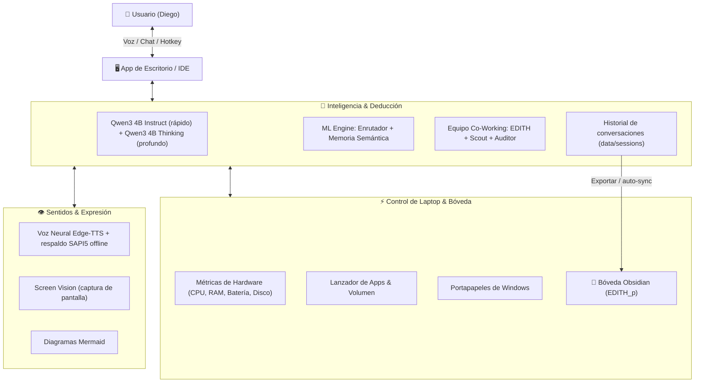
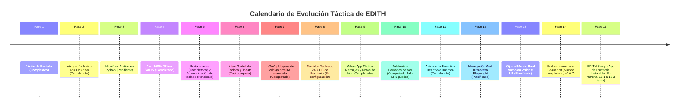

# 👓 Plan Maestro y Hoja de Ruta: E.D.I.T.H.

> [!info] Estado del Sistema
> **E.D.I.T.H.** (Enhanced Dialectical Intelligence & Tactical Heuristics) está en la versión **0.0.9**: ya habla por **WhatsApp (texto y notas de voz)**, contesta y hace **llamadas telefónicas** (Twilio) y tiene **iniciativa propia** (recordatorios, alarmas que escalan a llamada, salud de la laptop, tareas de Obsidian y resumen matutino). Todo sobre su motor dual Qwen3 (100 % GPU, ~1 s), LaTeX, visión de pantalla y Obsidian. Desde la **v0.0.6** es una app de escritorio y la **v0.0.7** protege la interfaz y la API con token y pide tu permiso antes de ejecutar comandos. La **v0.0.8** se configura sola la primera vez (asistente que mira tu GPU y descarga los modelos) y todo se cambia en ⚙️ Ajustes, sin editar `.env`. Desde la **v0.0.9** se empaqueta como `EDITH.exe`, que funciona sin la carpeta del proyecto ni Python, con WhatsApp incluido sin necesidad de Node.
>
> Pendiente inmediato: **Fase 8** (servidor 24/7 + URL pública), que es lo que permite que Twilio llegue a EDITH y que WhatsApp funcione con la laptop cerrada. Su requisito de seguridad (Fase 14) ya está listo en v0.0.7.
>
> Documentos clave:
> - [[Registro de Cambios de EDITH]]: detalle técnico de cada versión.
> - [[Arquitectura Servidor 24-7 y Comunicaciones (WhatsApp y Telefono)]]: diseño técnico de la PC de escritorio, WhatsApp y telefonía.
> - [[Dashboard de EDITH]]: centro de mando en Obsidian.
> - [[Guía de Configuración de Canales (WhatsApp, Teléfono y Heartbeat)]]: cómo activar las Fases 9-11 paso a paso.
> - [[Auditoria de Seguridad y Protecciones de EDITH]]: riesgos y endurecimiento (Fase 14).
> - [[Diseño de EDITH Setup (Aplicación de Escritorio)]]: instalador `EDITH-Setup.exe` y app nativa (Fase 15).

---

## 🗺️ Mapa de Arquitectura Actual



---

## ✅ Diagnóstico de Capacidades

### ✅ 1. Núcleo Lógico & Deductivo
- [x] Conexión nativa con **DeepSeek-R1** vía Ollama local.
- [x] Auto-detección y arranque silencioso de Ollama en segundo plano (solución a `[WinError 10061]`).
- [x] Razonamiento estructurado con separación de bloques `<think>`.
- [x] Codificación UTF-8 garantizada en Windows.

### ✅ 2. Machine Learning & Memoria Semántica (v0.0.2)
- [x] **`OnlineRouter`**: enrutador predictivo de intenciones.
- [x] **`SemanticMemory`**: recuerdos relevantes con enfriamiento dinámico.
- [x] **`compress_history`**: solo se envían al LLM los turnos relevantes.

### ✅ 3. Sentidos Visuales & Expresión
- [x] **Screen Vision** (`agent/tools/screen_tools.py`): captura completa y de ventana activa.
- [x] Identificación automática del programa activo.
- [x] Voz neural con 4 personalidades seleccionables.
- [x] Diagramas conceptuales renderizados en vivo.
- [x] 🆕 Las herramientas `capture_screen` / `analyze_screen` ya se ejecutan de verdad (antes el agente las anunciaba pero respondía "herramienta desconocida").

### ✅ 4. Entorno de Escritorio Nativo *(se convertirá en app instalable en la Fase 15)*
- [x] App independiente (`pywebview`) con icono propio.
- [x] Lanzadores con comprobación de `.venv`.

### ⚡ 5. Velocidad (v0.0.3)
- [x] **Respuesta en vivo**: el texto aparece mientras EDITH escribe ("escribiendo.") en lugar de esperar al final.
- [x] **Voz en paralelo**: la respuesta se muestra al instante y el audio llega después (antes el texto esperaba a que terminara la síntesis de voz).
- [x] **Modelo precargado** al abrir EDITH (`OLLAMA_WARMUP`) y mantenido en memoria 30 min (`OLLAMA_KEEP_ALIVE`).
- [x] **Prompt de sistema estable**: los recuerdos/lecciones de cada consulta van en un mensaje aparte, así Ollama reutiliza la caché del historial en vez de reprocesarlo todo en cada mensaje.
- [x] **Prompt de herramientas compacto**: ya no se repiten los esquemas JSON de todas las herramientas dentro del prompt (viajan solo en el campo nativo `tools`).
- [x] Conexión HTTP persistente con Ollama y reintento automático si el modelo no soporta `tools`/`think`.
- [x] Ventana de contexto fija en **4096** (medido en la RTX 4050: 17.7 tok/s vs 14.7 tok/s con 8192) y la precarga usa las mismas opciones, evitando una recarga de ~10 s.
- [x] Flash attention + caché KV de 8 bits cuando EDITH arranca Ollama.

### 🗂️ 6. Historial de Conversaciones (v0.0.3)
- [x] Panel **"Historial de conversaciones"** en la barra lateral, agrupado por *Hoy / Ayer / Últimos 7 días / Últimos 30 días / mes*.
- [x] Clic en una charla → se carga completa en el chat **y EDITH retoma ese contexto**.
- [x] **Búsqueda** por título y por contenido de los mensajes.
- [x] Renombrar ✎, eliminar 🗑 y **guardar en Obsidian** 💎 cada conversación.
- [x] "Nueva conversación" ahora crea una sesión real (antes solo limpiaba la pantalla).
- [x] Al abrir EDITH se muestra la conversación en curso; el título se toma del primer mensaje.

---

## 🧭 Hoja de Ruta Táctica (15 Fases)



### ✅ Fase 2: Integración Profunda con Obsidian
> [!tip] Objetivo
> Convertir esta bóveda en la memoria externa oficial y cuaderno táctico de EDITH.

- [x] **`agent/tools/obsidian_tools.py`** (trabaja directo sobre los `.md`, no necesita plugin ni API key):
  - `obsidian_create_note(title, content, folder, tags)`
  - `obsidian_append_note(title, content)`
  - `obsidian_read_note(title)`
  - `obsidian_search(query)`
  - `obsidian_sync_session()` → guarda la charla en `01 - Diario/`
- [x] **Estructura de carpetas** (se crea sola):
  - `00 - Dashboard/` · `01 - Diario/` · `02 - Proyectos/` · `03 - Conocimiento/` · `04 - Memoria EDITH/`
- [x] **Sincronización automática** opcional: `OBSIDIAN_AUTO_SYNC=true` en `.env` archiva cada conversación al terminar el turno (en segundo plano).
- [x] Ruta de la bóveda configurable con `OBSIDIAN_VAULT_PATH`.
- [ ] Guardar `workspace/notas_del_dia.md` y los diagramas directamente en la bóveda.

### 🎙️ Fase 3: Micrófono Nativo en Python (Hot-Mic)
- [ ] Captura directa de hardware con `speech_recognition` o capturador nativo.
- [ ] Activación continua diciendo *"Oye EDITH"* sin depender de los permisos de WebView2.

### ✅ Fase 4: Voz 100% Offline (Fallback SAPI5)
- [x] Si `edge-tts` falla o no hay internet (espera máx. 20 s), EDITH habla con la voz de Windows (SAPI5, prefiere voz en español) → nunca se queda muda. Se controla con `VOICE_OFFLINE_FALLBACK`.

### 🟡 Fase 5: Portapapeles & Control de Laptop (*Computer Use*)
- [x] `read_clipboard`: *"EDITH, explica lo que acabo de copiar"*.
- [x] `write_clipboard`: EDITH te deja un texto listo para `Ctrl+V` (acentos y emojis incluidos).
- [ ] Automatización de teclado para tareas repetitivas.

### 🟡 Fase 6: Atajo Global de Invocación & Notificaciones Toast
- [x] Hotkey global `Win + Shift + E` para mostrar/ocultar EDITH desde cualquier programa (v0.0.6, configurable con `EDITH_HOTKEY`).
- [x] Los avisos aparecen como **EDITH** con su logo, no como "Windows PowerShell" (v0.0.6).
- [x] Notificaciones nativas de Windows (toast) para recordatorios y alertas del Heartbeat (v0.0.5).
- [ ] Toast al terminar tareas largas en segundo plano (Co-Working, descargas).

### ✅ Fase 7: Matemáticas en LaTeX y Código de Nivel Profesional
> [!tip] Objetivo
> Que las respuestas de EDITH se vean como las de las IAs más avanzadas (ChatGPT, Claude, Gemini): fórmulas bien tipografiadas y código legible, copiable y ejecutable.

**Fórmulas matemáticas (LaTeX)**
- [x] Renderizar LaTeX en el chat con **KaTeX** (rápido, sin servidor): `$...$` en línea y `$$...$$` en bloque, además de `\(...\)` y `\[...\]`.
- [x] Proteger las fórmulas antes de pasar el texto por `marked` (que si no rompe `_`, `*` y `\`).
- [x] Instruir a EDITH en el prompt de sistema: toda expresión matemática en LaTeX, p. ej. $E = mc^2$ o
  $$\int_0^1 x^2\,dx = \frac{1}{3}$$
- [x] Entornos `aligned`, `cases`, `matrix` para desarrollos paso a paso (KaTeX).
- [ ] Ecuaciones numeradas y referencias cruzadas.
- [x] Botón para **copiar la fórmula en LaTeX** (útil para pegarla en Obsidian, que también usa MathJax).
- [x] La voz debe leer las fórmulas en lenguaje natural ("x al cuadrado"), no los comandos LaTeX.
- [x] Al exportar a Obsidian, conservar `$...$` tal cual: Obsidian las renderiza nativamente.

**Bloques de código**
- [x] Resaltado de sintaxis con **highlight.js** según el lenguaje del bloque (` ```python `).
- [x] Cabecera de cada bloque con el **nombre del lenguaje** y botón **📋 Copiar**.
- [x] Botón **💾 Guardar en workspace**.
- [ ] Botón **▶ Ejecutar** (para Python, con confirmación).
- [ ] Números de línea y ajuste de líneas largas opcional.
- [x] `código en línea` con estilo monoespaciado diferenciado.

**Detalles finos**
- [x] Render en vivo también durante el streaming (hoy se muestra texto plano hasta el final).
- [x] Tablas Markdown con estilo y scroll horizontal en móvil.

---

### 🖥️ Fase 8: Servidor Dedicado 24/7 (Home AI Server & Malla Tailscale) — *en configuración por Diego*
> [!tip] Objetivo
> Mudar el cerebro de EDITH a una PC de escritorio para que "viva" 24/7 sin límites de batería ni suspensión de laptop, accesible de forma segura desde cualquier lugar.
> 
> Nota técnica completa: [[Arquitectura Servidor 24-7 y Comunicaciones (WhatsApp y Telefono)]].

- [ ] **Setup Servidor en PC de Escritorio**:
  - Ollama y FastAPI corriendo como servicios persistentes de Windows / Linux (Systemd / NSSM).
  - Modelos más densos (14B / 32B) aprovechando VRAM dedicada superior sin estrangulamiento térmico.
  - Wake-on-LAN y reinicio automático programado tras cortes de energía.
- [ ] **Malla Cifrada P2P con Tailscale (WireGuard Zero-Trust)**:
  - Sin abrir puertos en el módem/router.
  - Conexión cifrada directa entre laptop, celular y PC de escritorio desde cualquier red Wi-Fi o datos móviles.
- [ ] **Clientes Ligeros**:
  - Tu laptop ejecuta la interfaz gráfica conectada por red a la PC; uso de CPU/GPU de la laptop: ~0 %.
- [ ] **URL pública HTTPS para Twilio** (`PUBLIC_BASE_URL`): Tailscale Funnel o Cloudflare Tunnel hacia `/api/voice/*` y `/ws/voice`. Es lo único que falta para activar las llamadas de la Fase 10.
- [x] Antes de exponer nada a la red: **autenticación de la interfaz y la API** (Fase 14, v0.0.7). Al abrir EDITH en red: añade el nombre o la IP de Tailscale a `EDITH_ALLOWED_HOSTS` y entra desde cada dispositivo con el enlace que muestra `python main.py --access-link`.

### ✅ Fase 9: WhatsApp Táctico (Mensajes, Notas de Voz y Alertas) — v0.0.5
> [!tip] Objetivo
> Llevar a EDITH en el bolsillo: chatear con ella por WhatsApp, enviarle y recibir notas de voz, y recibir avisos proactivos.

- [x] **Bridge WhatsApp con Baileys v7** (`bridges/whatsapp/bridge.mjs`): vinculación por QR (en la terminal o en *Laptop > Canales y autonomía*), EDITH lo arranca sola, reconexión automática.
- [x] **Notas de voz bidireccionales**: audio → `faster-whisper` local → EDITH → respuesta como **nota de voz Ogg/Opus** con su voz (sin ffmpeg). Medido: ~4.5 s de punta a punta.
- [x] **Alertas proactivas por WhatsApp**: recordatorios, alarmas críticas ("responde *ok* o te llamo") y resumen matutino (Fase 11).
- [x] Conversación propia por contacto que aparece en el historial; `/nuevo` empieza otra.
- [x] **Seguridad**: lista blanca obligatoria (`AUTHORIZED_PHONE_NUMBERS`), silencio total con desconocidos, API del bridge solo en `127.0.0.1` con clave compartida, sin PowerShell/apps/pantalla desde WhatsApp.
- [ ] Imágenes y documentos por WhatsApp (hoy: texto y notas de voz).
- [ ] Probar con un número secundario real (requiere escanear el QR).

### ✅ Fase 10: Llamadas Telefónicas Bidireccionales (Twilio Voice) — v0.0.5
> [!tip] Objetivo
> Hablar con EDITH en tiempo real por llamada telefónica tradicional (sin app abierta) o que ella te llame para urgencias y alarmas.

- [x] **Llamadas salientes de alarma**: si no confirmas una alarma crítica en `ESCALATE_AFTER_MINUTES`, EDITH te llama; pulsas **1** para confirmar.
- [x] **Llamadas entrantes, modo `gather`** (por turnos): funciona con cualquier cuenta de Twilio. Si EDITH tarda, dice "dame un momento" en vez de colgarse por el límite de 15 s de Twilio.
- [x] **Llamadas entrantes, modo `relay`** (tiempo real con ConversationRelay): la respuesta se transmite token a token. Requiere activar ConversationRelay en la consola de Twilio.
- [x] **Seguridad**: firma `X-Twilio-Signature` verificada en cada webhook, números desconocidos rechazados **sin contestar** (no cuesta), token de un solo uso por llamada.
- [ ] **Activar en producción**: requiere `PUBLIC_BASE_URL` (Fase 8) y credenciales de Twilio en `.env`.
- [ ] Llamadas delegadas ("llama al restaurante y pregunta el horario").
- [ ] Voz propia de EDITH en llamadas (hoy usa voces de Twilio: Polly/Google).

### ✅ Fase 11: Autonomía Proactiva (Heartbeat Daemon) — v0.0.5
> [!tip] Objetivo
> Que EDITH deje de ser puramente reactiva y tenga iniciativa propia.

- [x] **Heartbeat** (`agent/heartbeat/daemon.py`): recordatorios cada minuto; salud de la laptop y tareas de Obsidian cada `HEARTBEAT_MINUTES`.
- [x] **Recordatorios y alarmas**: "recuérdame mañana a las 9…", "avísame en 30 minutos…", "alarma urgente el viernes 7:30, si no contesto llámame". Repetición diaria/semanal. También desde *Laptop > Recordatorios*.
- [x] **Escalado**: alarma crítica sin confirmar → llamada (o reenvío si no hay Twilio).
- [x] **Tareas de Obsidian con fecha** (`📅 AAAA-MM-DD`, `due:: AAAA-MM-DD` o `@AAAA-MM-DD`): avisa de las de hoy y las vencidas.
- [x] **Salud de la laptop**: batería baja sin cargador, CPU al máximo sostenida, disco casi lleno.
- [x] **Resumen matutino** (`MORNING_BRIEFING_TIME`): redactado por EDITH, enviado a WhatsApp/interfaz y guardado en `01 - Diario/`. Noticias opcionales (`HEARTBEAT_NEWS_TOPICS`).
- [x] **Horas de silencio** (`QUIET_HOURS`): de noche solo pasan los avisos críticos.
- [ ] Calendario (Google/Outlook) y correo: requieren conectar tus cuentas (OAuth/IMAP).

### 🌐 Fase 12: Navegación Web Interactiva (*Computer Use / Playwright*)
- [ ] Automatización de navegador Chromium headless con Playwright: iniciar sesión, llenar formularios, descargar PDFs y comparar precios.

### 👁️ Fase 13: Ojos en el Mundo Real (Webcam Vision & IoT)
- [ ] Conexión con cámara web: reconocimiento facial al sentarte en el escritorio y análisis visual de objetos físicos.
- [ ] Integración con Home Assistant: control de luces y enchufes inteligentes.

### 🛡️ Fase 14: Endurecimiento de Seguridad
> [!success] Requisito de la Fase 8: listo (v0.0.7)
> La interfaz, la API y el chat exigen un token (en la laptop entra sola; desde otro dispositivo, con el enlace de `python main.py --access-link`). PowerShell y abrir apps piden tu permiso en pantalla. Detalle: [[Auditoria de Seguridad y Protecciones de EDITH]] y [[Registro de Cambios de EDITH]].

- [x] Lista blanca de números para WhatsApp y teléfono (v0.0.5).
- [x] Sin PowerShell, apps, pantalla ni portapapeles desde canales remotos (v0.0.5).
- [x] Firma de Twilio, clave del bridge y tokens de llamada de un solo uso (v0.0.5).
- [x] Corregido el escape del workspace por prefijo de ruta (v0.0.5).
- [x] Token de acceso para la interfaz, la API y el WebSocket del chat, y validación de `Origin`/`Host` (v0.0.7).
- [x] Confirmación humana en la interfaz antes de ejecutar PowerShell o abrir apps; `open_application` sin `shell=True` (v0.0.7).
- [x] Marcar el contenido de webs y archivos como "dato no confiable" para que no dé órdenes a EDITH; tras leerlo, las acciones sensibles piden confirmación (v0.0.7).
- [x] Sanitizar el HTML que genera el modelo antes de mostrarlo (DOMPurify 3.4.16 con SRI; imágenes externas bloqueadas) (v0.0.7).
- [x] Sacar `data/sessions/` del repositorio de git (contiene tus conversaciones) (v0.0.7).
- [ ] Content-Security-Policy completa (quitar los `onclick` en línea de la interfaz).
- [ ] Fijar la versión de `marked`, `mermaid` y `chart.js` en el CDN.
- [ ] Confirmación por WhatsApp para comandos pedidos desde remoto.
- [ ] Límite de peticiones por minuto y cifrado de secretos con DPAPI.
- [ ] Sacar también `data/memory/` y `data/audio/` del repositorio.
- [x] Sacar de git la configuración de los plugins de Obsidian (`.obsidian/plugins/*/data.json`) (v0.0.8).
- [ ] **Regenerar la API key y los certificados del plugin Local REST API**: se publicaron en GitHub con el commit `7446bb0`.

### 📦 Fase 15: EDITH Setup — Aplicación de Escritorio Instalable
> [!tip] Objetivo
> Instalar EDITH con un solo **`EDITH-Setup.exe`**, como cualquier app: sin terminal, sin Python a mano, sin editar `.env`. Ventana propia sin consola, icono junto al reloj, asistente de primer arranque y actualizaciones.
>
> Diseño completo: [[Diseño de EDITH Setup (Aplicación de Escritorio)]].

> [!success] 15.1 lista (v0.0.6)
> EDITH ya se abre como app: `EDITH.exe` sin consola, icono junto al reloj, cerrar = ocultar, una sola instancia y datos en `%LOCALAPPDATA%\EDITH`. Los accesos directos del Escritorio y del menú Inicio apuntan a `EDITH.exe`. El empaquetado (15.3, v0.0.9) quitó la dependencia del `.venv` de la carpeta del proyecto.

**✅ 15.1 · App nativa (sin instalador todavía) — v0.0.6**
- [x] `EDITH.exe` sin consola: ventana WebView2 + núcleo en segundo plano (lanzador nativo de 96 KB).
- [x] Icono en la bandeja del sistema: abrir, nueva conversación, pausar avisos 1 h, carpeta de datos, salir.
- [x] Cerrar la ventana la oculta; EDITH sigue con Heartbeat, WhatsApp y recordatorios. Apagar Windows no se bloquea.
- [x] Una sola instancia; puerto 8000 o el siguiente libre (8001-8010); registros en `%LOCALAPPDATA%\EDITH\logs`.
- [x] Datos en `%LOCALAPPDATA%\EDITH` con copia única desde `data/` y `workspace/` del proyecto.
- [x] Notificaciones con nombre y logo de EDITH.
- [x] Atajo global `Win + Shift + E`.
- [x] Pantalla "Iniciando…" mientras arranca, y WebView2 recuerda el permiso del micrófono.
- [x] Ajustes desde la app (15.2, v0.0.8): se guardan en el `.env` activo; en la app empaquetada (v0.0.9) es `%LOCALAPPDATA%\EDITH\.env`.

> [!success] 15.2 lista (v0.0.8)
> La primera vez, un asistente de 7 pasos deja EDITH configurada: mira tu GPU y recomienda los modelos, los descarga con progreso, elige la bóveda, la voz, WhatsApp y la iniciativa propia. Después todo se cambia en **⚙️ Ajustes** y se aplica al momento. Detalle: [[Registro de Cambios de EDITH#v0.0.8 — 16/10/2026 · Asistente de primer arranque y Ajustes (Fase 15.2)]].

**✅ 15.2 · Asistente de primer arranque y Ajustes — v0.0.8**
- [x] Diagnóstico de GPU/RAM/disco con recomendación de modelos según la VRAM.
- [x] Descarga de modelos con barra de progreso, pausa y reanudación.
- [x] Elegir bóveda de Obsidian (selector de carpetas nativo), voz con muestras, números autorizados, WhatsApp (QR) y Twilio (opcional).
- [x] Panel **⚙️ Ajustes** en la app y en el icono junto al reloj; los cambios se aplican sin reiniciar. El `.env` queda solo para desarrollo.
- [x] «Iniciar EDITH con Windows» (arranca oculta en la bandeja) y validación con mensajes claros.
- [x] Pruebas en `tests/test_fase_15_2.py` (65 casos), junto a las de la Fase 14.

> [!success] 15.3 lista (v0.0.9)
> `build\build_setup.ps1` construye `dist\EDITH\EDITH.exe`, que arranca sin la carpeta del proyecto ni Python, y `edith-whatsapp.exe` para usar WhatsApp sin instalar Node. Detalle: [[Registro de Cambios de EDITH#v0.0.9 — 16/10/2026 · EDITH empaquetada, sin el proyecto ni el .venv (Fase 15.3)]].

**✅ 15.3 · Empaquetado — v0.0.9**
- [x] PyInstaller en modo carpeta → `EDITH.exe` (+ `_internal/`), sin consola y con icono (401 MB).
- [x] Bridge de WhatsApp como `edith-whatsapp.exe` opcional (esbuild + Node SEA, 97 MB), sin exigir Node.
- [x] Archivo `VERSION` único y script `build/build_setup.ps1` que lo construye todo y lo autocomprueba.
- [x] Modo empaquetado: `.env` y datos en `%LOCALAPPDATA%\EDITH`, interfaz e iconos dentro del paquete; numpy, scikit-learn, faster-whisper, PyAV, pygame y edge-tts comprobados dentro del `.exe`.
- [x] Pruebas en `tests/test_fase_15_3.py` (23 casos) y con la app empaquetada real en `--tray` (12/12).

**15.4 · Instalador `EDITH-Setup.exe` (Inno Setup)**
- [ ] Instalación por usuario, sin permisos de administrador.
- [ ] Detecta Ollama y, si falta, lo instala con el instalador oficial.
- [ ] Accesos directos en Escritorio y menú Inicio; opción "Iniciar con Windows" (ya existe en Ajustes desde la v0.0.8).
- [ ] Componente opcional "WhatsApp".
- [ ] Desinstalador que pregunta si conservar conversaciones y ajustes.

**15.5 · Actualizaciones y distribución**
- [ ] Aviso de versión nueva y actualización conservando datos.
- [ ] Decidir firma de código (SmartScreen avisará si no se firma).
- [ ] Modo *cliente de mi servidor* (requiere Fases 8 y 14).
- [ ] Enlace de acceso para otros dispositivos desde la app (hoy solo `python main.py --access-link`, que no existe en la app empaquetada).
- [ ] Prueba completa en una cuenta de Windows nueva o máquina virtual.

> [!warning] Dependencias
> Antes de construir el instalador: sacar `data/sessions/` de git (Fase 14, hecho en v0.0.7). Para el modo cliente: Fases 8 y 14. Tamaño medido en la v0.0.9, sin comprimir: 401 MB (`dist\EDITH`) + 97 MB del bridge opcional; los modelos (~5 GB) se descargan aparte.

---

## ⚡ Cuello de botella de velocidad - RESUELTO (v0.0.4)
> [!success] Antes → ahora
> `deepseek-r1:8b` no cabía en la GPU (25-30 % en CPU) y siempre razonaba: **20-33 s** por respuesta simple.
> Ahora `qwen3:4b-instruct` (100 % GPU) responde en **0.1-1.5 s al primer texto**, y `qwen3:4b` *Thinking* solo entra para matemáticas, lógica y depuración (~12-20 s).
> Detalle y mediciones: [[Registro de Cambios de EDITH#v0.0.4 — 15/10/2026 · Cuello de botella resuelto + LaTeX]].

**Siguientes ideas de velocidad**
- [ ] Evitar el cambio de modelo (~6-8 s) si algún día ambos caben juntos (más VRAM o un modelo híbrido que respete `think=false`).
- [ ] Clasificar "pensar a fondo" con el enrutador ML en vez de solo palabras clave, aprendiendo de cuándo el usuario pulsa 🔬 Profundo.

---

## 🔗 Enlaces y Notas Relacionadas
- [[Registro de Cambios de EDITH]]: detalle técnico de cada versión.
- [[Bienvenido]]: nota de bienvenida de la bóveda.
- `01 - Diario/`: conversaciones archivadas desde EDITH.

---
*Actualizado el 16/10/2026 - versión 0.0.9.*
