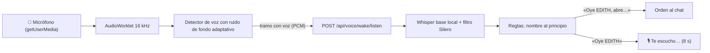

# 📜 Registro de Cambios de E.D.I.T.H.

Bitácora técnica de cada versión. Plan general: [[Plan de Cambios y Evolución de EDITH]].

---

## v0.1.0 — 17/10/2026 · Todo lo que faltaba, menos el servidor
Pedido de Diego: «haz todo lo que falta menos lo del servidor». Queda fuera lo que necesita la PC servidor (Fase 8): la URL pública de las llamadas, las llamadas delegadas, el modo cliente y la webcam (Diego la conectará al servidor). Commits `bb3428d` a `09b6323` en `main`, encima de la v0.0.10 (voces y «Oye EDITH», `a471a60`).

> [!success] En una frase
> EDITH ya escribe por ti en cualquier ventana, navega webs con su propio Edge, maneja tu casa con Home Assistant, lee tu calendario y tu correo, entiende fotos y documentos por WhatsApp, te avisa cuando termina algo largo y se instala con un `EDITH-Setup.exe`. Y todo con más candados: secretos cifrados, límites, permiso por WhatsApp y una CSP estricta.

### 🛡️ Fase 14 completa
- **Secretos cifrados con DPAPI** (`agent/secret_store.py`, sin dependencias): el token de acceso, la clave del bridge y los secretos que guardas en Ajustes (Auth Token de Twilio, token de Home Assistant, enlaces iCal, contraseña del correo) van en disco como `dpapi:…`. Solo tu cuenta de Windows en esta PC los lee. Los archivos viejos en claro se cifran solos al leerlos. El bridge recibe su clave por variable de entorno.
- **Límite de peticiones** (`agent/ratelimit.py`): desde otro dispositivo, 240 peticiones/min; tokens incorrectos, 10/min por IP y luego `429` con `Retry-After` (en la laptop una cookie vieja no bloquea); consultas al modelo, 20/min por cliente (chat y WhatsApp). Se cambian en `.env`.
- **Confirmación por WhatsApp**: con `REMOTE_ALLOW_SYSTEM_TOOLS=true`, cada acción sensible pedida desde el celular manda *«🔐 EDITH quiere ejecutar…: responde SI 4821 o NO»*. Un «sí» suelto o con otro código no vale; sin respuesta en 2 min se rechaza. Desde una llamada se sigue rechazando.
- **CSP estricta**: `script-src 'self'` (sin scripts en línea, sin `eval`, sin CDN). Las librerías viven en `ide/static/vendor/` con versión fija y huella SHA-256 verificada contra jsdelivr (`build/vendor_libs.py`, `MANIFEST.json`): marked 15.0.12, DOMPurify 3.4.16, KaTeX 0.16.11, highlight.js 11.9.0, Mermaid 10.9.8, Chart.js 4.5.1 y las fuentes. **La interfaz ya funciona sin internet.** (La URL sin versión de `marked` en realidad servía la 15.0.12.)
- `data/memory/`, `data/audio/` y `data/learnings/` salen de git (siguen en disco).

### ⌨️ Fase 5 · Teclado
`keyboard_actions`: escribe texto (acentos, ñ, emojis) y pulsa atajos en una ventana por su título. Todos los pasos se autorizan **de una vez**; si cambias de ventana a mitad, EDITH se detiene; nunca escribe en su propia ventana. Solo desde la laptop.

### 🔔 Fase 6 · Aviso al terminar
La pestaña avisa si la estás mirando. Si una respuesta tarda más de 25 s (`LONG_TASK_NOTIFY_SECONDS`) y no la mirabas, llega una notificación de Windows con el principio de la respuesta. Igual al terminar de descargar modelos. Respeta «Avisar por» de Ajustes.

### 💎 Fase 2 · Bóveda
Cada diagrama se copia como nota a `03 - Conocimiento/Diagramas` (Obsidian dibuja Mermaid) y `notas_del_dia.md` al Diario de hoy (`AAAA-MM-DD - Notas del día`). Si no tienes bóveda no se crea nada. Se apaga en Ajustes › Obsidian.

### 🌐 Fase 12 · Navegador propio
EDITH maneja un **Microsoft Edge propio** con Playwright (perfil en `%LOCALAPPDATA%\EDITH\browser`, sin ventana). Ve cada página como texto + elementos numerados.
- Leer, seguir enlaces y rellenar campos: sin preguntar. **Pulsar botones y descargar: siempre con tu permiso** (el aviso dice qué botón y en qué página).
- **Nunca escribe contraseñas, códigos ni datos de tarjeta**: abre la ventana (`browser_show`) para que los escribas tú.
- Lo que lee de la web es dato no confiable. Para ahorrar contexto al modelo, solo `browser_open` está siempre a la vista; el resto aparece con una página abierta.

### 🏠 Fase 13 · Home Assistant
Luces, enchufes, ventiladores, clima, reproductores y escenas (Ajustes › Casa y cuentas: dirección y token de larga duración). **Nunca cerraduras, alarmas, garajes ni persianas.** Tras leer una web o un correo, manejar la casa pide permiso. La **webcam** queda para cuando Diego la conecte al servidor.

### 📅 Fase 11 · Calendario y correo
- **Calendario**: enlaces iCal de Google u Outlook (también `webcal://`), con eventos repetidos.
- **Correo IMAP de solo lectura** con contraseña de aplicación: abre el buzón con `EXAMINE` y lee con `BODY.PEEK`, así que **no marca, no borra, no envía**.
- El **resumen matutino** suma tu agenda de hoy y los correos sin leer (como datos: no sigue instrucciones que traigan).

### 📷 Fase 9 · Fotos y documentos por WhatsApp
- Mándale una **foto** con una pregunta (o sin texto: la describe) o un **PDF, Word o texto** (sin texto: lo resume). Máximo 10 MB.
- El documento queda en `workspace/recibidos`. Lo que trae se marca como no confiable y las acciones sensibles de ese turno piden permiso.
- **Visión local**: `agent/vision.py` usa un modelo de Ollama (`VISION_MODEL`, por defecto `qwen3-vl:4b`, unos 3 GB) y Gemini como respaldo. `analyze_screen` también prueba primero el local. **Falta descargar el modelo** (Ajustes › Modelos de IA); sin él, EDITH lo dice en vez de inventar.

### 🧠 Razonamiento que aprende de ti
Cada vez que eliges 🔬 Profundo o ⚡ Rápido, un clasificador en línea aprende. En modo automático solo **añade** casos a la heurística, tras 5 elecciones tuyas y con certeza ≥ 0.75.

### 🧮 Fase 7 · LaTeX y código
- `\label{…}` + `\eqref{…}`/`\ref{…}` numeran y citan ecuaciones como en LaTeX; los entornos `equation`/`align` sueltos también se dibujan. Una cita rota sale «(??)».
- Cada bloque de código tiene **#** (números de línea) y **↩** (ajustar líneas); la preferencia se recuerda. El resaltado no se rompe en cadenas de varias líneas.
- **▶ Ejecutar** en bloques Python: te muestra el código y pide confirmación; corre en `workspace/ejecuciones`, 30 s como máximo, sin los secretos de EDITH y **solo desde esta computadora**. En `EDITH.exe` usa su propio intérprete (`--run-python`).

### 🎙️ «Oye EDITH» con la app en la bandeja
Si la ventana está oculta y dices «Oye EDITH», la ventana aparece para que veas la respuesta.

### 📦 Fase 15.4 · `EDITH-Setup.exe` (Inno Setup 6)
- `build\build_setup.ps1` ahora también compila `dist\EDITH-Setup-0.1.0.exe` (168 MB).
- **Instalación**: por usuario y sin administrador, en `%LOCALAPPDATA%\Programs\EDITH`.
- **Opcional**: WhatsApp, acceso directo, «Iniciar con Windows» y **descargar Ollama del sitio oficial si falta**.
- **Antes de instalar o desinstalar** cierra EDITH con su evento.
- **Al desinstalar** pregunta si borrar tus datos (**«No» por defecto; en silencio nunca**) y quita el inicio con Windows si apuntaba a esa instalación.

### 🔄 Fase 15.5 · Actualizaciones
La app instalada mira una vez al día el último *release* en GitHub (`SantirokcanX/E.D.I.T.H`). Si hay versión nueva, avisa con **Descargar / Ahora no**. Instalar encima reemplaza solo el programa: tus conversaciones y ajustes se conservan. Se apaga en Ajustes › Avanzado.

### 🧪 Pruebas
| Suite | Resultado |
|---|---|
| `test_seguridad_extra.py` (DPAPI, límites, WhatsApp, datos fuera de git) | 44/44 |
| `test_teclado_avisos.py` (teclado simulado, avisos, bóveda) | 37/37 |
| `test_navegador.py` (Edge real sin ventana contra una tienda local) | 25/25 |
| `test_integraciones.py` (Home Assistant, iCal e IMAP simulados) | 39/39 |
| `test_whatsapp_media.py` (PDF y Word reales, visión simulada, aprendizaje) | 31/31 |
| `test_interfaz.py` (CSP, librerías locales, ▶ Ejecutar) | 32/32 |
| `test_actualizaciones.py` (GitHub simulado y script del instalador) | 29/29 |
| Anteriores: voz 67, 15.3 48, 15.2 65, seguridad 78, Fases 9-11 55 | 313/313 |
| **Total** | **550/550** |

- **Navegador integrado (CSP activa)**: KaTeX, Mermaid, tablas, resaltado y fuentes locales sin ningún bloqueo. Ecuaciones (1) y (2) citadas, números de línea y ajuste. ▶ Ejecutar: «Cancelar» no ejecuta; «Ejecutar» → `45 ñ`; un error sale en rojo.
- **Paquete**: autocomprobación de `EDITH.exe` **13/13** (incluye Playwright con su driver, PDF y calendario).
- **Instalador real**: **14/14**. Instaló en silencio en una carpeta temporal en 16 s, el `EDITH.exe` instalado pasó su autocomprobación y desinstaló sin dejar archivos. Tus accesos directos, el inicio con Windows, tus datos y tu EDITH abierta quedaron intactos.

### 📌 Lo que queda
- **Del servidor (Fase 8)**: URL pública (llamadas), llamadas delegadas, voz propia en llamadas, modo cliente, webcam.
- **Decisiones tuyas**: firma de código (sin firma, SmartScreen avisará al instalar; opciones en [[Diseño de EDITH Setup (Aplicación de Escritorio)]]) y publicar el primer *release* en GitHub para que funcione el aviso de versiones.
- **Pasos tuyos**: **regenerar la API key del plugin Local REST API** (sigue en el historial público), descargar el modelo de visión, probar WhatsApp con un número real y configurar Casa y cuentas si quieres usarlas.
- **En pausa**: micrófono nativo en Python (con la app en la bandeja WebView2 sigue escuchando y el permiso se recuerda) y evitar el cambio de modelo (necesita más VRAM).

---

## v0.0.10 — 17/10/2026 · Voces que suenan distinto, voz «Viernes» y «Oye EDITH» con Whisper local
Rama `claude/eloquent-perlman-e610ae`, encima de `main` (`36aac2e`). Tres problemas de voz: todas las voces sonaban igual, faltaba una voz con estilo «Viernes» y «Oye EDITH» no funcionaba en la app. Primero se midió la causa de cada uno.

### 🔊 Por qué todas las voces sonaban igual
- **Causa**: `edge-tts` 7.2.8, la versión del `.venv` del proyecto. Microsoft cambió el token `Sec-MS-GEC` y **rechazaba con un 403 todas las peticiones**: Elvira, Dalia, Ximena y Salomé fallaban igual. La 7.3.1 genera el token nuevo y con ella las cuatro funcionan (comprobado una a una).
- El error **se tragaba en silencio** (`except Exception`): EDITH pasaba a la voz de Windows (SAPI5), y en esta laptop la única voz española instalada es *Microsoft Sabina (es-MX)*. Por eso todas las opciones sonaban idénticas. El aviso de Ajustes decía «sin conexión», aunque sí había internet.
- No era la caché (cada audio lleva un nombre único), ni `set_voice`, ni la lectura de `EDITH_VOICE`: las tres cosas funcionaban.
- A quién afectaba: a EDITH abierta desde el código (`.venv` del proyecto, que usan el lanzador de desarrollo y la EDITH de cada día). Según la tabla de la v0.0.9, `EDITH.exe` empaquetado se construyó con `build\.venv` y edge-tts 7.3.1.

**Arreglo**
- `requirements.txt` pide `edge-tts>=7.3.1` y el `.venv` del proyecto ya la tiene. **Hay que reiniciar la EDITH abierta**, porque conserva cargada la 7.2.8.
- Si la voz neural falla, EDITH registra el motivo (`edith.voz` en el registro) y Ajustes lo muestra: «El servicio de voz de Microsoft rechazó la conexión (error 403)…», «tardó demasiado», «sin conexión»… Además avisa de que, sin la voz neural, todas las opciones suenan igual.
- El respaldo SAPI5 elige la voz de Windows de la región de cada voz (es-ES, es-MX, es-CO) si está instalada. Con una sola voz española instalada, sin internet siguen sonando igual, y Ajustes lo dice.
- El selector de voz de la barra lateral **ahora guarda la voz** en el `.env` (antes solo la cambiaba hasta reiniciar), y solo desde esta computadora. Las opciones salen de EDITH, así que una voz nueva aparece sola.

Muestras reales generadas por la ruta de Ajustes (`/api/setup/voice/sample`), cada una con su voz neural:

| Voz | Voz neural | Duración | Tono medio |
|---|---|---|---|
| Elvira | `es-ES-ElviraNeural` | 5,40 s | 193 Hz |
| Dalia | `es-MX-DaliaNeural` | 5,33 s | 198 Hz |
| Ximena | `es-ES-XimenaNeural` | 5,16 s | 208 Hz |
| Salomé | `es-CO-SalomeNeural` | 5,11 s | 182 Hz |
| Viernes | `en-US-AvaMultilingualNeural` | 4,25 s | 216 Hz |

### 🎭 Voz «Viernes»
Estilo de la asistente de Tony Stark (F.R.I.D.A.Y.): femenina, serena y precisa, con un leve acento. **Es un estilo de voz, no una imitación de la actriz.**
- Edge no tiene voces británicas ni irlandesas que hablen español. Se probaron sintetizando una frase en español y transcribiéndola con Whisper:

| Voz | Similitud con el texto |
|---|---|
| `en-IE-EmilyNeural` (irlandesa) | 0,16: lee el español con fonética inglesa, no se entiende |
| `en-GB-SoniaNeural` (británica) | 0,17: igual |
| Multilingües femeninas: Ava, Emma (EE. UU.), Vivienne (Francia), Seraphina (Alemania), Thalita (Brasil) | 0,96 (como Elvira) |

- Elegida: **`en-US-AvaMultilingualNeural`** («cálida y clara»), a `-4%` de velocidad y `-3Hz` de tono. Habla español con un leve acento inglés: es lo más cerca del aire británico o irlandés que permite el motor. Whisper detecta español y transcribe la muestra casi palabra por palabra.
- Sale en ⚙️ Ajustes › Voz, en el paso «Elige mi voz» del asistente (con ▶ Escuchar) y en la barra lateral. Sin internet usa la voz de Windows de España si está instalada.

### 🎙️ «Oye EDITH»: qué fallaba
1. **En la app de escritorio no funcionaba nunca.** Usaba el reconocimiento de voz del navegador (Web Speech API). Probado en una ventana WebView2 oculta: `SpeechRecognition` existe, abre el micrófono y a los 1,1 s falla con `network`. Tras 3 fallos se apagaba («sin servicio de voz»).
2. En Chrome o Edge sí funcionaba, pero **enviaba a la nube todo lo que oía el micrófono**.
3. **Falsos positivos por subcadena**: buscaba `"edit"` en el texto, así que saltaba con «editar», «Edita la foto», «la editorial», «Meredith», «le dije a Edith…». También con su propia voz: «Hola, soy EDITH» la despertaba, porque nada la silenciaba mientras hablaba.
4. Según el código: actuaba sobre resultados provisionales. Con «Oye EDITH, abre la calculadora» podía enviar solo «abre» en cuanto aparecía la primera palabra tras el nombre.
5. Según el código: tras «Oye EDITH» sin orden se quedaba escuchando **para siempre**. Lo siguiente que oyera (la tele, otra persona) se enviaba como orden, con el nombre dentro.
6. `agent/voice/wake_word.py` existía, pero no lo usaba nadie.

### 🎙️ «Oye EDITH»: cómo funciona ahora

- **Todo en local**: el audio no sale de la computadora. Funciona igual en la app (WebView2 recuerda el permiso del micrófono) y en el navegador.
- **Solo los tramos con voz** van a Whisper. Antes de que empiece la voz se guardan 0,3 s y el tramo termina tras 0,6 s de silencio (1 s al dictar la orden), con un máximo de 8 o 15 s. Se descartan los ruidos de menos de 0,3 s. El umbral se adapta al ruido de la habitación y depende de la sensibilidad.
- **No se oye a sí misma**: mientras suena la voz de EDITH, y 0,7 s después, no se capta nada.
- **Reglas** (`WakeWordDetector`): el nombre tiene que ir al principio de la frase, solo o tras un saludo (oye, hey, hola, buenos días, ¿qué hay?…). No cuentan las palabras parecidas (editar, edita, editorial, Meredith, crédito…). Tampoco cuenta el nombre si lo que sigue empieza con un artículo («EDITH, la foto…» era «Edita la foto…»).
- **Pista para Whisper** (`Oye EDITH, hola EDITH.`): sin ella, Whisper escribe el nombre como «dit», «edic» o «Eddie» y **solo detectaba 26 de 64 llamadas**. Para que la pista no cree falsos positivos: si Whisper copia la pista en vez de la orden, EDITH se queda escuchando la orden, y un «EDITH» suelto con más de 1 s de voz (sin márgenes, según Silero) se descarta.
- **Reinicio tras errores**: sin permiso de micrófono lo dice y se reintenta con el botón. Sin micrófono, o si se desconecta o está ocupado, reintenta con espera creciente (1 s → 30 s) y al enchufar uno. Si EDITH no responde, lo indica y sigue intentando. Si el modelo no está, muestra «Preparando…» mientras lo descarga. Si la política de audio del navegador lo bloquea, pide un clic.
- **Pausar suelta el micrófono** (se apaga el indicador de Windows) y se recuerda. El botón 🎙️ dicta una orden aunque «Oye EDITH» esté en pausa o desactivado.
- **Ajustes › Voz**: «Escuchar «Oye EDITH»», sensibilidad y modelo (`WAKE_WORD_ENABLED`, `WAKE_WORD_SENSITIVITY`, `WAKE_WORD_MODEL`). Los cambios se aplican sin recargar la página.

| Sensibilidad | Qué hace |
|---|---|
| Baja | Solo el nombre a secas: «Oye EDITH», pitido y luego la orden. Sin formas dudosas del nombre |
| Normal (recomendada) | Nombre + orden de un tirón; acepta cómo escribe Whisper el nombre («dit», «edic»…) |
| Alta | Además acepta nombres peor oídos («Edet»), hasta 4 palabras de saludo delante |

**Medido** con 184 frases sintetizadas por 8 voces de Edge (hombres y mujeres de España, México, Argentina, Colombia, Chile, Perú y EE. UU.), limpias y con ruido a 10 dB, por el mismo camino que la app (PCM → `WakeListener.listen`):

| | Llamadas detectadas | Falsos positivos (120 frases que no la llaman) | La regla antigua, con el mismo texto |
|---|---|---|---|
| Normal, sin ruido | **59/64** | **3/120** | 53/120 |
| Normal, con ruido | **59/64** | **9/120** | 43/120 |
| Baja, sin ruido / con ruido | 23/24 y 21/24 (nombre a secas) | **0/120** y **0/120** | — |
| Ruido sin voz | — | 0/20 | — |

- Todos los falsos positivos que quedan vienen de dos frases que suenan casi igual que una llamada: «Hoy Edith no vino a trabajar» (Whisper oye «Oye EDITH, no vino…») y «Oye, edita ese párrafo». En la sensibilidad baja no se activan.
- Latencia media por tramo en la CPU de esta laptop (Whisper base int8): **340–480 ms**; la primera, con el modelo recién cargado, ~1,2 s. Con la laptop muy cargada (1,7 GB de RAM libre y otras tareas pesadas) una pasada de las pruebas llegó a **24 s de media**: Whisper compite por CPU y memoria. Repetida sin esa carga, 483 ms.
- Con Whisper base, «pon música» llega a veces como «con música», con o sin pista. Con `WAKE_WORD_MODEL=small` se entiende mejor, a cambio de más tiempo y 460 MB.

### 🔧 Piezas técnicas
| Archivo | Qué hace |
|---|---|
| `agent/voice/voice_engine.py` | Voz `viernes`, `last_error` y `describe_error()`; respaldo SAPI5 por región |
| `agent/voice/wake_word.py` | `WakeWordDetector` (reglas y sensibilidad) y `WakeListener` (modelo en segundo plano, una transcripción a la vez, pista, Silero) |
| `ide/voice_api.py` | `GET /api/voice/wake/status`, `POST /api/voice/wake/prepare` y `POST /api/voice/wake/listen` (token y Origin, como toda la API; máximo 15 s; 409 si está desactivado) |
| `ide/static/wake-worklet.js` + `app.js` | Captura, detector de voz, modo «Te escucho…», reintentos; sin `SpeechRecognition` |
| `ide/setup_api.py`, `ide/static/setup.js` | Motivo real en la muestra de voz; aplicar «Oye EDITH» sin reiniciar |
| `ide/server.py` | El selector de la barra lateral guarda la voz |
| `agent/config.py`, `agent/setup/settings.py`, `.env.example` | `WAKE_WORD_*` y la voz «Viernes» en Ajustes y en el asistente |
| `requirements.txt` | `edge-tts>=7.3.1` |

### 🧪 Pruebas
- **`python tests/test_voz.py`: 67/67** (nuevo; necesita internet). Comprueba la versión de edge-tts, que cada voz use su voz neural (y exista en el catálogo de Microsoft) y que las cinco muestras sean audios distintos y suenen distinto (tono o duración). También que «Viernes» se entienda en español, el motivo cuando falla la voz neural (403 simulado), el respaldo SAPI5 y que la voz se guarde desde la barra lateral. De «Oye EDITH» prueba las reglas (8 llamadas y 10 frases que no la llaman), las rutas (token, Origin, 413, 409, ocupado) y el audio real: 4 voces × 10 frases, con y sin ruido, con al menos un 85 % de detección y ningún falso positivo (sale 15/16 y 16/16, 0/24 y 0/24; la regla antigua, con el mismo texto, 16–17/24 y 9/24), y que la media no pase de 1,5 s por tramo (483 ms). Una de las pasadas falló solo en esto (24 s de media con la laptop sin RAM libre); repetida, 67/67.
- Siguen pasando: `test_fase_15_3.py` **48/48**, `test_fase_15_2.py` **65/65**, `test_seguridad.py` **78/78** y `test_fases_9_11.py` **55/55**.
- **Interfaz real en el navegador integrado**, con un servidor aislado (`EDITH_HOME` temporal) y un micrófono simulado que reproducía grabaciones con ruido de fondo:
  - «Hola, soy EDITH. ¿En qué te puedo ayudar?» y «Voy a editar el documento» → nada.
  - «Oye EDITH, abre la calculadora» → envía «abre la calculadora» al chat.
  - «Oye EDITH» → «🎙️ Te escucho…» → la frase siguiente va al chat y vuelve a «activo».
  - Una llamada tapada por la voz de EDITH → nada.
  - Pausar → suelta el micrófono.
  - El botón 🎙️ con «Oye EDITH» en pausa dicta una orden y suelta el micrófono.
  - Sin permiso de micrófono → «sin permiso», sin bucle de reintentos.
  - En el asistente aparece «Viernes» y su ▶ Escuchar da audio neural.
- No se tocaron tus datos ni tu EDITH abierta: todo con `EDITH_HOME` temporales.

### 📌 Pendiente
- **Reiniciar la EDITH abierta** para que cargue edge-tts 7.3.1. **Reconstruir `EDITH.exe`** (`build\build_setup.ps1`) para llevar «Oye EDITH» y «Viernes» a la app empaquetada.
- Si «Oye EDITH» se activa con la ventana oculta en la bandeja, la orden llega al chat pero la ventana no se muestra.
- Fase 3: captura nativa del micrófono en Python (sin WebView2). Hoy depende del permiso de micrófono de WebView2, que la app recuerda.
- Probar con la voz real de Diego y su micrófono (las medidas son con voces sintetizadas) y ajustar la sensibilidad si hace falta.

---

## v0.0.9 — 16/10/2026 · EDITH empaquetada, sin el proyecto ni el .venv (Fase 15.3)
Commits `b2ee9eb` (empaquetado) y `1c95838` (enlace para otro dispositivo), en `main` encima de la v0.0.8 (`8ce8d38`). Tercera entrega de la Fase 15: **EDITH ya es un programa de verdad**. `dist\EDITH\EDITH.exe` arranca sin la carpeta del proyecto, sin el `.venv` y sin tener Python instalado, y WhatsApp funciona sin instalar Node. Diseño: [[Diseño de EDITH Setup (Aplicación de Escritorio)]].

### 📦 Qué se construye
Un solo comando, `powershell -NoProfile -ExecutionPolicy Bypass -File build\build_setup.ps1` (unos 4 min la primera vez y 2 min después):

| Paso | Qué hace | Resultado |
|---|---|---|
| 1 · Entorno limpio | `build\.venv` con Python 3.13 + `requirements.txt` + PyInstaller 6.22.3 (se reutiliza en las siguientes construcciones) | Demuestra que `requirements.txt` está completo |
| 2 · PyInstaller | `build\edith.spec`, modo carpeta, sin consola, sin UPX (da menos falsos positivos de antivirus) | `dist\EDITH\EDITH.exe` + `_internal\` · **401 MB** |
| 3 · Bridge de WhatsApp | esbuild junta el bridge en un solo `bridge.cjs` → Node SEA lo inyecta en una copia de `node.exe` (postject) | `dist\EDITH\edith-whatsapp.exe` · **97 MB** (Node 24.22) |
| 4 · Autocomprobación | `EDITH.exe --self-test` y `edith-whatsapp.exe --check` con datos temporales | 11/11 y «Baileys cargado» |

Total: **498 MB** con WhatsApp. Sin el bridge entra en lo estimado (250–450 MB). Los modelos siguen sin ir dentro: se descargan en el asistente.

### 🔢 Versión única
- Archivo **`VERSION`** en la raíz (`0.0.9`). Lo leen la app (`/api/version`, el registro, el icono de la bandeja «EDITH 0.0.9»), la interfaz, la spec (el recurso de versión de `EDITH.exe`: *Propiedades → Detalles*) y el lanzador C# de desarrollo (`build_launcher.bat` genera `AssemblyVersion 0.0.9.0`).
- La interfaz se sirve con `?v=0.0.9` en el CSS y el JavaScript: tras actualizar, WebView2 no se queda con un `app.js` viejo. Antes eran 4 números que había que cambiar a mano en `index.html`.
- El instalador (15.4) y el actualizador (15.5) leerán el mismo archivo.

### 🧊 EDITH.exe frente al código fuente
| Pieza | Desde el código | En `EDITH.exe` |
|---|---|---|
| Interfaz, iconos y `VERSION` | Carpeta del proyecto | `_internal\` (dentro del paquete) |
| `.env` | El del proyecto si existe | Siempre `%LOCALAPPDATA%\EDITH\.env` (lo escribe ⚙️ Ajustes) |
| Datos | `%LOCALAPPDATA%\EDITH` (copia única de `data/` y `workspace/` del proyecto) | `%LOCALAPPDATA%\EDITH`; no hay proyecto del que copiar |
| Bridge de WhatsApp | `node bridge.mjs` si hay Node; si no, el `.exe` de `dist\EDITH` | `edith-whatsapp.exe` junto a `EDITH.exe`; nunca pide Node |
| Iniciar con Windows | El lanzador `EDITH.exe` del proyecto | El propio `EDITH.exe --tray` |
| Bóveda por defecto | `Documentos\EDITH_proyecto\EDITH_p` | La misma si existe; en otra PC, `Documentos\EDITH` |

- **Tus ajustes de esta laptop no se pierden**: la primera vez que se abra la app empaquetada sin `.env` propio, copia una sola vez el `.env` del proyecto que indica la marca `%LOCALAPPDATA%\EDITH\.migrado_desde_proyecto`. Después cada una tiene el suyo: la app empaquetada usa el de `%LOCALAPPDATA%\EDITH` y el código, el del proyecto.
- **Una instancia por carpeta de datos**: con un `EDITH_HOME` propio (pruebas, copia portátil) el mutex y los eventos llevan una huella de la carpeta (`Local\EDITH_Desktop_Quit_xxxxxxxx`). Así una copia de prueba no muestra ni cierra tu EDITH. La EDITH normal conserva los nombres de siempre (el desinstalador de la 15.4 usará `Local\EDITH_Desktop_Quit`).
- Si algo falla al arrancar sale un solo aviso (PyInstaller añadía un segundo cuadro de «excepción no controlada»). Además, `multiprocessing.freeze_support()` evita que un proceso hijo vuelva a abrir la app.
- Voz de Windows (SAPI5): no hay nada que empaquetar porque usa `System.Speech` a través de PowerShell. La autocomprobación genera un WAV de prueba.

### 🔍 Dependencias pesadas, comprobadas dentro del .exe
| Dependencia | Cómo se comprobó |
|---|---|
| numpy 2.5.4 · scipy 1.18.1 · scikit-learn 1.9.1 | Entrena un `SGDClassifier` con `HashingVectorizer`, lo mismo que usa el enrutador ML |
| faster-whisper 1.2.1 · ctranslate2 4.8.3 · onnxruntime 1.31 | Carga el filtro de silencio `silero_vad_v6.onnx`, un recurso que PyInstaller no copiaba solo; CPU con int8/float32 |
| PyAV 19.0.1 | WAV → OGG/Opus → 16 kHz, como una nota de voz de WhatsApp |
| pygame 2.6.1 · edge-tts 7.3.1 | Mezclador de audio iniciado |
| pywebview 6.2.1 · pythonnet 3.2.1 · WebView2 · pystray 0.19.5 | Plataforma WinForms cargada y bandeja `_win32` |
| FastAPI | `/api/version` y la página principal, con token |

`requirements.txt` no tenía **pystray ni Pillow**: el `.venv` de esta laptop los tenía instalados aparte, pero en un entorno limpio la bandeja no habría funcionado. Ya están.

### 💬 WhatsApp sin Node
- `edith-whatsapp.exe` = Node 24 + el bridge entero (Baileys v7 con su WebAssembly, protobuf, pino y qrcode) en un archivo. Se quedan fuera las librerías de imagen opcionales de Baileys (sharp, jimp): solo se pierden las miniaturas.
- `bridge.mjs` ya no usa `await` de nivel superior (Node SEA ejecuta CommonJS) y tiene `--check` para comprobar el ejecutable sin conectarse.
- `ide/channels_api.py`: en la app usa `edith-whatsapp.exe` junto a `EDITH.exe`. Desde el código usa `node bridge.mjs` si Node está instalado (los cambios se prueban al momento) y, si no, el `.exe` de `dist\EDITH`. *Canales* informa `bridge_available` y el aviso del QR ya no dice «instala Node».
- Probado sin Node: arranca, **genera el QR real de vinculación de WhatsApp** y su API local solo responde con la clave (401 sin ella).

### 🔗 Enlace para otro dispositivo, desde la app
La app empaquetada no trae `main.py`, así que `python main.py --access-link` ya no servía en ella.
- **⚙️ Ajustes › Avanzado › «Copiar enlace para otro dispositivo»**: copia el enlace de `PUBLIC_BASE_URL` (y ofrece los de `EDITH_ALLOWED_HOSTS`) **sin mostrar el token en pantalla**. Si no hay ninguno configurado, explica cómo hacerlo; si el portapapeles falla, muestra el enlace seleccionado para copiarlo a mano.
- Lo sirve `POST /api/setup/access-link`, que exige el token, el mismo `Origin` y el navegador de esta máquina (127.0.0.1, sin túnel ni proxy), con `Cache-Control: no-store`.
- **`EDITH.exe --access-link`** muestra el enlace sin abrir la app (en la terminal, o en un cuadro de Windows si no hay terminal).
- La página «🔒 EDITH está protegida», el aviso de arranque y `.env.example` citan Ajustes y la orden de cada modo (`EDITH.exe` o `python main.py`), con el puerto real.

### 🔧 Piezas técnicas
| Archivo | Qué hace |
|---|---|
| `VERSION` | Versión única de EDITH |
| `build/edith.spec` | PyInstaller: punto de entrada `desktop/desktop_app.py`, recursos, DLL de ctranslate2, recurso de versión e icono |
| `build/build_setup.ps1` | Construcción completa (entorno, PyInstaller, bridge, autocomprobación); `-Clean`, `-NoWhatsApp`, `-SkipSelfTest` |
| `build/requirements-build.txt` | PyInstaller fijado en 6.22.3 |
| `desktop/self_test.py` | `EDITH.exe --self-test`: 11 comprobaciones sin ventanas |
| `agent/paths.py` | `FROZEN`, `INSTALL_DIR`, `VERSION`, `.env` según el modo y adopción única del `.env` del proyecto |
| `ide/server.py` | Interfaz desde el paquete, `/api/version` y la página con la versión |
| `ide/channels_api.py` | `bridge_command()`: `.exe` empaquetado o Node |
| `desktop/desktop_app.py` | `--self-test`, `--access-link`, una instancia por carpeta de datos, versión en el registro y la bandeja, y sin el falso `ERROR` de asyncio (`ConnectionResetError` 10054 cuando WebView2 corta una conexión) |
| `ide/auth.py`, `ide/setup_api.py`, `ide/static/setup.js` | Enlace para otro dispositivo: página de acceso con la orden de cada modo, `POST /api/setup/access-link` y el botón de Ajustes |
| `desktop/launcher/` | Lanzador de desarrollo; toma la versión de `VERSION` |

### 🧪 Pruebas
- **`python tests/test_fase_15_3.py`: 48/48** (23 del empaquetado y 25 del enlace para otro dispositivo). Cubren la versión en la API, la interfaz, el lanzador y la spec; el `.env` en modo empaquetado; la adopción del `.env` (una sola vez y sin pisar uno existente); la elección del bridge con y sin Node y en la app; `bridge.mjs` sin `await`; los nombres de instancia, y la autocomprobación desde el código (11/11).
- Siguen pasando: `tests/test_fase_15_2.py` **65/65**, `tests/test_seguridad.py` **78/78** y `tests/test_fases_9_11.py` **55/55**.
- `build\build_setup.ps1` completo: autocomprobación **11/11** y `edith-whatsapp OK · Node 24.22.0 · Baileys cargado`.
- **App empaquetada real: 12/12**. Se copió a una carpeta temporal fuera del proyecto, sin `.venv` en el PATH, con `EDITH_HOME` temporal y `--tray`, sin tocar la pantalla. Arranca en el puerto 8000 y `/api/version` → `packaged: true`. El asistente queda pendiente y la ventana oculta (WebView2) carga la interfaz sin el token en la URL y **muestra el asistente «Hola, soy EDITH 👓»** (comprobado dentro de WebView2 con su puerto de depuración). La interfaz enlaza `app.js?v=0.0.9`. Ajustes, guardado desde la propia interfaz, escribe en `EDITH_HOME\.env` (`EDITH_VOICE=dalia`, `QUIET_HOURS`) y aplica la voz al momento. Detecta `edith-whatsapp.exe` y se cierra en orden con `Local\EDITH_Desktop_Quit_<huella>`.
- **Al integrar en `main` (17/10/2026)**, con el código final (incluido el enlace): las 4 suites pasan (**246/246**), `build\build_setup.ps1` desde cero en 9.3 min (autocomprobación **11/11**, bridge OK, 498 MB) y la app empaquetada real, oculta con `--tray`: **13/13** (versión `0.0.9 · packaged`, la ventana entra con el token y WebView2 guarda la cookie `HttpOnly`, sin token → 401, «Iniciar con Windows» apunta al `EDITH.exe` empaquetado con `--tray` y se borra, otro origen → 403, salida ordenada y registro sin errores). Tu EDITH abierta siguió funcionando durante las pruebas.
- Tus datos reales no se tocaron: 0 archivos modificados en `%LOCALAPPDATA%\EDITH`, y el registro de notificaciones (AppUserModelId) se restauró tras cada prueba. La prueba arrancó Ollama, que no estaba abierto; al terminar se cerró.

### 📌 Pendiente
- **15.4 · Instalador** (Inno Setup) sobre `dist\EDITH`, con `edith-whatsapp.exe` como componente opcional.
- `edith-whatsapp.exe` lleva el icono y los datos de `node.exe`, y su firma queda rota al inyectar el bridge (postject lo avisa). Firmar los dos ejecutables entra en la decisión de firma de la 15.5.
- `dist\` y `build\.venv` no van a git. Para probar en otra PC basta copiar la carpeta `dist\EDITH` (o esperar al instalador).

---

## v0.0.8 — 16/10/2026 · Asistente de primer arranque y Ajustes (Fase 15.2)
Commits `8cea1f8` (asistente y Ajustes) y `3466373` (pruebas), en `main` encima de la v0.0.7. Segunda entrega de la Fase 15: EDITH se configura sola la primera vez y todo se cambia desde la app, sin editar `.env`. Diseño: [[Diseño de EDITH Setup (Aplicación de Escritorio)]].

> [!note] Numeración
> Se desarrolló como «0.0.7», pero ese número lo tomó la Fase 14 (seguridad), así que sale como **v0.0.8**.

### 🧙 Asistente de primer arranque (7 pasos)
Aparece solo la primera vez que se abre EDITH (en la app o en el navegador). **«Configurar más tarde»** lo cierra para siempre: todo queda en ⚙️ Ajustes.

| Paso | Qué pide | Detalle |
|---|---|---|
| 1 · Bienvenida | Tu nombre | Va a la memoria a largo plazo: EDITH te llama por tu nombre en todas las conversaciones |
| 2 · Tu equipo y mis modelos | Modelo rápido y profundo | Diagnóstico de procesador, RAM, GPU, disco de los modelos y Ollama → recomendación según la VRAM. Si faltan modelos: **descarga con barra de progreso, pausa y reanudación** |
| 3 · Tu bóveda de Obsidian | Carpeta | Botón **«Elegir…»** (selector de carpetas de Windows, solo en la app), **«Comprobar»** (existe, cuántas notas, se puede escribir) y crear las carpetas `00–04` si está vacía |
| 4 · Elige mi voz | Elvira, Dalia, Ximena, Salomé | **▶ Escuchar** cada una; si no hay internet avisa de que sonará la voz de Windows |
| 5 · WhatsApp y teléfono | Números autorizados, WhatsApp, QR | Opcional. Twilio y la URL pública van en «Avanzado» |
| 6 · Iniciativa propia | Heartbeat, resumen matutino, horas de silencio, avisos | También **«Iniciar EDITH con Windows»** (solo en la app) |
| 7 · ¡Lista! | — | Resumen de lo elegido |

**Recomendación de modelos** (`agent/setup/hardware.py`):

| GPU dedicada | Rápido | Profundo |
|---|---|---|
| 24 GB o más | `qwen3:14b` | `qwen3:32b` |
| 16 GB | `qwen3:8b` | `qwen3:14b` |
| 10–12 GB | `qwen3:8b` | `qwen3:8b` (híbrido: el mismo para los dos modos) |
| 4–8 GB (esta laptop) | `qwen3:4b-instruct` | `qwen3:4b` |
| Sin GPU dedicada | `qwen3:1.7b` | `qwen3:4b` (lento) |

Con menos de 8 GB de RAM baja a los modelos pequeños. Antes de descargar comprueba que haya espacio (descarga + 2 GB de margen).

### ⚙️ Panel de Ajustes
- Botón **⚙️ Ajustes** en la barra lateral y en el menú del icono junto al reloj. Los mismos campos que el asistente, en 7 pestañas: *Tú, Modelos de IA, Obsidian, Voz, WhatsApp y teléfono, Autonomía, Avanzado*.
- **Se aplica al momento, sin reiniciar**: modelos (y los precarga en la GPU), voz, precisión de Whisper, WhatsApp (reinicia el bridge) y Heartbeat (lo enciende o apaga). Solo el puerto y el atajo global piden reiniciar, y lo indican.
- Se guarda en el `.env` activo: el del proyecto mientras EDITH corre desde el código; `%LOCALAPPDATA%\EDITH\.env` cuando no hay proyecto (la app instalada de la 15.3). Se conservan los comentarios y las demás claves.
- El Auth Token de Twilio se muestra como `••••••••`; si no se toca, se conserva.
- **Validación con mensajes claros**: rutas completas, números en formato internacional (8–15 dígitos; se aceptan espacios, guiones y paréntesis y se guardan normalizados), URL pública solo `https://`, horas `HH:MM`, rangos numéricos y puerto `auto` o 1024–65535.
- **Iniciar con Windows**: crea `HKCU\…\Run\EDITH` → `EDITH.exe --tray` (sin permisos de administrador). Con `--tray` EDITH arranca oculta en la bandeja.

### 🔒 Seguridad
- Las rutas que cambian ajustes, descargan modelos o crean carpetas exigen el token de la v0.0.7 y además solo aceptan peticiones de esta computadora (`Host` 127.0.0.1/localhost) y de la propia EDITH (`Origin` igual): otra web abierta en el navegador no puede cambiarlos y, **desde otro dispositivo, aunque tenga el token, Ajustes responde 403** (el chat sí funciona).
- Cada ajuste es una sola línea: los saltos de línea se rechazan, así nadie puede colar otra clave en el `.env` (p. ej. `REMOTE_ALLOW_SYSTEM_TOOLS=true`). Las claves que no son de Ajustes se ignoran.
- «Iniciar con Windows» solo se acepta desde la app de escritorio.

### 🔐 Limpieza del repositorio
- El commit `7446bb0` («Gran actualizacion 0.0.4») subió la bóveda a git, incluido `EDITH_p/.obsidian/plugins/obsidian-local-rest-api/data.json` con la **API key y las claves privadas de los certificados** del plugin Local REST API, y el repositorio de GitHub es público.
- Ahora ese archivo sale de git y `**/.obsidian/plugins/*/data.json` va al `.gitignore` (el archivo sigue en tu bóveda y el plugin funciona igual). Al fusionar la Fase 14 también salen de git las dos sesiones de `data/sessions/` (los archivos se conservan).

> [!danger] Pendiente tuyo
> Lo que ya se publicó sigue en el historial de GitHub: **regenera la API key y los certificados** en Obsidian → Ajustes → Local REST API, y actualiza la clave donde la uses (por ejemplo, la conexión MCP de Obsidian). Para borrarlo también del historial habría que reescribirlo (force push) o hacer privado el repositorio.

### 🐛 Corregido de paso
- **«Oye EDITH» ya no reintenta sin parar** si el micrófono está bloqueado o no hay servicio de voz (en la app de escritorio WebView2 puede no tenerlo): se pausa y el botón dice *«sin micrófono»* o *«sin servicio de voz»*; al pulsarlo vuelve a intentarlo. Los reintentos normales esperan cada vez más. (Era un pendiente de la v0.0.7.)
- El Heartbeat no podía volver a encenderse después de apagarlo.
- La app de escritorio guardaba el puerto que le tocó como si fuera tu ajuste: ahora usa `EDITH_RUNTIME_PORT` y tu `EDITH_PORT` queda intacto.

### 🔧 Piezas técnicas
| Archivo | Qué hace |
|---|---|
| `agent/setup/hardware.py` | GPUs (`nvidia-smi` + registro de Windows, separa la integrada), CPU, RAM, disco, Ollama y recomendación |
| `agent/setup/models.py` | Descargas con `/api/pull` de Ollama en segundo plano: progreso, cancelar y reanudar |
| `agent/setup/settings.py` | Esquema único de ajustes (asistente y panel), validación y guardado en `.env`; `setup.json` en `%LOCALAPPDATA%\EDITH` |
| `ide/setup_api.py` | `/api/setup/*` y `/api/settings`; aplica los cambios en vivo |
| `ide/static/setup.js` | Asistente y panel de Ajustes |
| `desktop/desktop_app.py` | Selector de carpetas nativo, `--tray`, «Ajustes» en el menú de la bandeja |

### 🧪 Pruebas
- **`python tests/test_fase_15_2.py`: 65/65** (Ollama simulado y `.env` temporal: nunca toca tus datos ni descarga nada). Recomendación por VRAM y GPU integrada vs dedicada; diagnóstico; asistente pendiente/completado; 7 secciones; token de Twilio enmascarado; números, URL y horas normalizados; comentarios del `.env` conservados; 8 valores inválidos rechazados con su mensaje (incluido el salto de línea); claves desconocidas ignoradas; nombre a la memoria; modelos y voz aplicados en vivo; descarga completa, una a la vez, pausa y error de Ollama; bóveda (crear 00-04, reconocer `.obsidian`, contar notas); otra web, otro puerto, sin token, `Host` ajeno y otro dispositivo → rechazados.
- **Tras fusionar con la v0.0.7**: `tests/test_seguridad.py` **78/78** y `tests/test_fases_9_11.py` **55/55**.
- **App de escritorio real con el token** (oculta con `--tray`, sin tocar la pantalla): 12/12. La ventana entra con su enlace (WebView2 guarda la cookie `HttpOnly`), sin token → 401, «Iniciar con Windows» crea y borra la entrada, otro origen → 403, salida ordenada y sin errores en el registro.
- **Navegador**: el asistente aparece solo en el primer arranque; diagnóstico real de esta laptop (Ryzen 5 8645HS, RTX 4050 de 6 GB —la Radeon integrada se descarta—, 30.3 GB libres, Ollama 0.34.4) → recomienda `qwen3:4b-instruct` + `qwen3:4b`, que ya están instalados; descarga con progreso, pausa y reanudación (siguió desde el 19 %); errores de validación (ruta relativa, URL `http://`, número inválido); números normalizados; token de Twilio enmascarado; resumen final y Ajustes con sus 7 pestañas.
- **App de escritorio**: modo escritorio detectado; «Iniciar con Windows» crea y borra la entrada de inicio con `--tray`; otro origen recibe 403; `--tray` arranca oculta y «Abrir EDITH» la muestra; **«Elegir…» abre el selector «Seleccionar carpeta» de Windows** en la bóveda actual; salida ordenada.
- **«Oye EDITH»**: micrófono bloqueado → se pausa sin reintentar; 3 fallos de red seguidos → se pausa; «no-speech» sigue escuchando.

### 📌 Pendiente
- Regenerar la API key y los certificados del plugin Local REST API (ver arriba).
- ~~15.3 · Empaquetado con PyInstaller: es lo que permitirá usar `%LOCALAPPDATA%\EDITH\.env` sin la carpeta del proyecto.~~ Hecho en la v0.0.9.
- El registro de modelos de Ollama fue muy lento en la prueba (~150 KB/s): la descarga se puede pausar y seguir otro día.

---

## v0.0.7 — 16/10/2026 · Endurecimiento de seguridad (Fase 14)
Commit `eded747` (rama `claude/inspiring-rhodes-a46533`), **fusionado en `main` el 16/10/2026** con `b3afff3`. Es el requisito para mover EDITH al servidor 24/7 (Fase 8). Riesgos y estado: [[Auditoria de Seguridad y Protecciones de EDITH]].

> [!note] Numeración
> Se pensó como v0.0.6, pero ese número ya lo usa la app de escritorio (Fase 15.1), así que sale como **v0.0.7**.

### 🔑 Token de acceso para la interfaz, la API y el chat
| Pieza | Archivo | Qué hace |
|---|---|---|
| Token | `agent/channels/security.py` | `EDITH_API_TOKEN` o `%LOCALAPPDATA%\EDITH\data\channels\api_token` (se genera solo, fuera de git) |
| Guardián | `ide/auth.py` | Middleware para HTTP y WebSocket: token, `Host` y `Origin` |
| Enlace | `python main.py --access-link` | Muestra `http://…/?token=…` para abrir EDITH desde otro dispositivo |

- **En la laptop no cambia nada**: al abrir `http://localhost:8000` o la app de escritorio, la interfaz recibe sola una cookie `HttpOnly` + `SameSite=Lax` (JavaScript no puede leerla). Si la petición llega por un túnel o proxy (`X-Forwarded-For`…) no entra sola. Se desactiva con `EDITH_LOCAL_AUTOLOGIN=false`.
- **Desde otro dispositivo**: se abre una vez el enlace con token; EDITH guarda la cookie y redirige a `/` **quitando el token de la URL**. Sin token se ve la página «🔒 EDITH está protegida».
- **App de escritorio**: la ventana entra con ese mismo enlace al arrancar, así no depende del auto-login.
- **Scripts**: cabecera `Authorization: Bearer <token>`.
- **Host permitido** en todas las peticiones (`localhost`, `127.0.0.1`, el host de `PUBLIC_BASE_URL` y `EDITH_ALLOWED_HOSTS`): bloquea el *DNS rebinding*. Para Tailscale o la red local hay que añadir el nombre o la IP a `EDITH_ALLOWED_HOSTS`.
- **Origin del mismo sitio** en `/ws/chat` y en todo `POST`/`PATCH`/`DELETE`: otra web (o una app en `localhost:3000`) no puede mandar órdenes con tu cookie.
- `X-Frame-Options: DENY`: nadie puede incrustar EDITH en un iframe para engañarte con el botón «Autorizar».
- **Sin cambios** en las rutas con autenticación propia: bridge de WhatsApp (`X-Edith-Bridge-Secret`), webhooks de Twilio (firma) y `/ws/voice` (token de un solo uso). El QR de WhatsApp sí pide ahora el token (es una pantalla de la interfaz).

### ✋ Confirmación humana antes de actuar
- Antes de `run_system_command` (PowerShell) y `open_application`, la interfaz muestra **«EDITH quiere ejecutar: … ¿Autorizas?»** con el comando exacto. El foco empieza en **Rechazar** (un Enter por accidente no autoriza), `Esc` rechaza y, sin respuesta, se rechaza sola a los **120 s**.
- El agente espera la respuesta por el WebSocket: el chat ahora lee mensajes mientras EDITH trabaja (cola de consultas + confirmaciones por pestaña; otra pestaña no puede autorizar lo que se pidió en esta).
- En la terminal (`python main.py`) se pregunta con `¿Autorizas? [y/n]`.
- Desde WhatsApp o el teléfono no hay a quién preguntar: esas acciones **se rechazan** (falla cerrado), aunque `REMOTE_ALLOW_SYSTEM_TOOLS=true`.
- `open_application` ya **no usa `shell=True`**: abre con `os.startfile` (ShellExecute), así `"notepad & del archivo"` ya no ejecuta el borrado. Los botones del panel *Laptop* solo lanzan las apps conocidas.
- PowerShell y los lanzadores `.cmd` (como el de VS Code) corren **sin ventana de consola** (`CREATE_NO_WINDOW`): la app de escritorio ya no tiene consola y antes parpadeaba una ventanita negra.

### 🧪 Contenido externo = dato no confiable
- La salida de `web_search`, `read_web_page`, archivos del workspace, notas de Obsidian, portapapeles y pantalla llega al modelo envuelta en `[DATO NO CONFIABLE · origen: …]` entre `<<<CONTENIDO_EXTERNO>>>` y `<<<FIN_CONTENIDO_EXTERNO>>>` (el texto no puede cerrar el bloque por su cuenta). El prompt de sistema explica que es solo información.
- En un turno donde entró contenido externo, también piden confirmación: guardar archivos o diagramas, escribir en Obsidian, recordatorios, portapapeles, volumen y pantalla.
- En un turno donde se leyeron datos privados (notas, archivos, portapapeles, pantalla), **consultar internet pide confirmación**: así una instrucción escondida no puede sacar tus notas en una URL. Investigar en la web (buscar + leer páginas) sigue sin preguntar.
- El modo Equipo marca igual la evidencia web que lee Scout.

### 🧼 HTML saneado con DOMPurify
- `ide/static/render.js`: todo el HTML de cada respuesta pasa por **DOMPurify 3.4.16** (cdnjs, versión fija + SRI) antes de insertarse. Fuera: `<script>`, `onerror`/`onclick`, enlaces `javascript:`, `<style>`, formularios y botones falsos, `id`/`name` (nada puede hacerse pasar por el modal), CSS con `url()` o `position: fixed`.
- **Imágenes externas bloqueadas**: `` se convierte en un enlace en vez de cargarse sola (era una vía para filtrar datos).
- Los enlaces se abren en otra pestaña (`noopener noreferrer`).
- Sin las librerías (sin internet) se muestra texto plano, nunca HTML sin sanear.
- También escapados en `app.js`: las fuentes consultadas (títulos y URLs de la web), el código de los diagramas Mermaid (ahora `securityLevel: 'strict'`) y los nombres de archivo.

### 🗂️ Historial fuera de git
- `data/sessions/` en `.gitignore` y fuera del repositorio con `git rm --cached` (los archivos locales se conservan). Las sesiones reales ya viven en `%LOCALAPPDATA%\EDITH\data\sessions` (v0.0.6).

### 🧪 Pruebas
- Las pruebas pasan a vivir en el repositorio (`tests/`, con `EDITH_HOME` en una carpeta temporal: nunca tocan tus datos): `python tests/test_seguridad.py` y `python tests/test_fases_9_11.py`.
- **78/78** de la Fase 14: sin token → 401; token incorrecto → 401; enlace con token → cookie y redirección sin token; en local entra sola, pero no tras un proxy; `Host` ajeno → 400; `Origin` ajeno, otro puerto local o sin `Origin` → 403; bridge y Twilio siguen entrando con su propia clave o firma; `/ws/chat` rechaza sin token u Origin ajeno; PowerShell espera confirmación sin ejecutarse; rechazado o caducado → no se ejecuta; autorizado → una sola vez; contenido marcado; herramientas sensibles tras contenido externo; `open_application` sin shell; PowerShell sin ventana; la app de escritorio entra con su enlace aunque el auto-login esté apagado; `data/sessions` fuera de git.
- **55/55** de las Fases 9-11 siguen pasando (WhatsApp, notas de voz reales, Twilio con firmas, relay, Heartbeat), antes y después de fusionar `main`.
- **Navegador** (EDITH real en el puerto 8010): DOMPurify 3.4.16 cargado con SRI, la cookie no es visible para JavaScript, 17/17 casos de HTML malicioso neutralizados (`onerror`, `javascript:`, `<script>`, `<style>`, overlay con `position:fixed`, `<svg onload>`, imagen externa, CSS `url()`, formulario falso) sin romper KaTeX (en línea, en bloque y `\sqrt` en SVG), los bloques de código ni las tablas. Con el modelo real, «Ejecuta en PowerShell el comando Get-Date» abrió el modal con `Get-Date`; al **Rechazar** no se ejecutó y EDITH lo explicó.

> [!warning] Al fusionar en `main`
> El commit saca `data/sessions/session_20260926_141522.json` de git. En el checkout principal ese archivo tiene cambios sin guardar: hay que copiar `data/sessions/` aparte antes de fusionar y restaurarla después, o git se niega a fusionar (o lo borra).

### 📌 Pendiente (siguiente ronda)
- Content-Security-Policy completa (requiere quitar los `onclick` en línea de `index.html`).
- Fijar la versión de `marked`, `mermaid` y `chart.js` (hoy sin versión fija en el CDN).
- Confirmación por WhatsApp («responde *sí* para ejecutar») para usar PowerShell desde remoto.
- Límite de peticiones por minuto y cifrado de secretos con DPAPI (ver la auditoría).
- `data/memory/long_term_profile.json` y `data/audio/` siguen en git y también son personales.
- ~~«Oye EDITH» reintenta sin parar si el micrófono está bloqueado (llena la consola con `not-allowed`).~~ Resuelto en v0.0.8.

---

## v0.0.6 — 16/10/2026 · EDITH como app de escritorio (Fase 15.1)
Commit `ab67c32` (ya en `main`). Diseño: [[Diseño de EDITH Setup (Aplicación de Escritorio)]].

### 🖥️ Qué cambia al abrir EDITH
| Antes | Ahora |
|---|---|
| Acceso directo a `run_desktop.bat` con consola negra | `EDITH.exe` sin consola (accesos del Escritorio y menú Inicio actualizados) |
| Cerrar la ventana apagaba todo | Cerrar la **oculta**; sigue junto al reloj con Heartbeat, WhatsApp y recordatorios |
| Abrirla dos veces = dos EDITH peleando por el puerto | Una sola instancia: abrirla otra vez muestra la ventana |
| Puerto 8000 fijo (fallaba si estaba ocupado) | 8000 o el siguiente libre (8001-8010); fijo con `EDITH_PORT` |
| Avisos firmados por "Windows PowerShell" | Avisos de **EDITH** con su logo |
| Datos dentro de la carpeta del código | Datos en `%LOCALAPPDATA%\EDITH` |
| Pedía el micrófono en cada arranque | WebView2 con perfil persistente: lo pide una vez |

**Menú de la bandeja:** Abrir EDITH · Nueva conversación · Pausar avisos 1 h · Abrir carpeta de datos · Salir.
**Atajo global:** `Win + Shift + E` muestra u oculta EDITH (`EDITH_HOTKEY` para cambiarlo, `off` para desactivarlo).

### 🗂️ Nueva carpeta de datos: `%LOCALAPPDATA%\EDITH`
| Carpeta | Contenido |
|---|---|
| `data\` | sesiones, memoria, ML, aprendizajes, canales (clave del bridge y sesión de WhatsApp), recordatorios, estado del Heartbeat, audio |
| `workspace\` | archivos compartidos con EDITH |
| `logs\` | `edith-desktop.log` y `whatsapp-bridge.log` |
| `webview\` | perfil de la ventana (permisos y preferencias) |

- La primera vez que EDITH se abre desde la carpeta del proyecto, **copia** (no mueve) `data/` y `workspace/`; los originales quedan como respaldo. No sobrescribe nada ni copia la caché de audio. Lo hace una sola vez.
- Nunca migra desde copias de trabajo temporales (`.claude\worktrees`).
- Ajustes: siguen en el `.env` del proyecto; la app instalada (15.3) usará `%LOCALAPPDATA%\EDITH\.env`.

### 🔧 Piezas técnicas
- `agent/paths.py`: rutas centralizadas (13 módulos actualizados) y migración.
- `desktop/desktop_app.py`: reescrito. Mutex de instancia única, evento "mostrar", evento "cerrar" (para el futuro desinstalador), servidor Uvicorn en hilo con apagado ordenado, pystray, `RegisterHotKey` y aviso de fin de sesión de Windows.
- `desktop/launcher/EDITH.cs` + `build_launcher.bat`: `EDITH.exe` compilado con el compilador C# de Windows (sin instalar nada). `install_edith.bat` lo compila y crea los accesos directos.
- `desktop/assets/edith-app.ico`: icono cuadrado de 16 a 256 px. El `edith.ico` original mide 101×106 y Windows lo mostraba en blanco.
- Avisos: EDITH se registra como remitente en `HKCU\Software\Classes\AppUserModelId\EDITH.Desktop` (sin administrador); si Windows lo rechaza, usa el remitente anterior.

### 🧪 Pruebas con la app real
**15/15 OK:** arranque sin consola (interfaz lista en 4–5 s); con el 8000 ocupado elige el 8001; ventana visible con el icono de EDITH; bandeja; atajo registrado; datos en `EDITH_HOME`; cerrar = ocultar con el servidor activo; segunda instancia sale en 1.7 s y muestra la original; `Win+Shift+E` oculta y muestra; salir ordenado y puerto liberado; sin errores en el registro. Además: las 55 pruebas de las Fases 9-11 siguen pasando, la migración (6 casos) funciona y Windows acepta los avisos con remitente EDITH.

> [!warning] Incidente durante las pruebas (corregido)
> Una instancia de prueba arrancó a las 10:35 dentro de la ventana del resumen matutino y **sobrescribió `01 - Diario/2026-10-16 - Resumen matutino.md`**, que tu EDITH había creado a las 08:15. Ambas versiones usaban los mismos datos (sin recordatorios ni tareas); cambian la redacción y el porcentaje de batería. La versión de las 08:15 puede recuperarse en Obsidian → *Ajustes → Recuperación de archivos*.
> **Corrección:** el Heartbeat ya no sobrescribe un resumen existente del mismo día. Esto también evita duplicados cuando haya una EDITH en la laptop y otra en el servidor (Fase 8). Las pruebas ahora aíslan también la bóveda.

---

## v0.0.5 — 15/10/2026 · WhatsApp, llamadas y autonomía proactiva (Fases 9, 10 y 11)
Commit `e1581e4` (ya en `main`). Configuración paso a paso: [[Guía de Configuración de Canales (WhatsApp, Teléfono y Heartbeat)]].

### 💬 Fase 9 — WhatsApp
| Pieza | Archivo | Qué hace |
|---|---|---|
| Bridge Baileys v7 | `bridges/whatsapp/bridge.mjs` | Enlaza WhatsApp por QR; reenvía chats privados autorizados a EDITH |
| Canal | `agent/channels/whatsapp.py` | Procesa texto/voz, formato WhatsApp, `/nuevo`, "ok" confirma alarmas |
| Notas de voz | `agent/channels/voice_notes.py` | `faster-whisper` local + transcodificación a Ogg/Opus con PyAV |
| Conversaciones | `agent/channels/conversations.py` | Un agente por contacto, con su memoria y herramientas limitadas |

### 📞 Fase 10 — Teléfono (Twilio Voice)
- `agent/channels/telephony.py`: modos `gather` (por turnos) y `relay` (ConversationRelay en tiempo real), llamadas de alarma con "pulsa 1".
- Rutas: `POST /api/voice/incoming`, `/api/voice/gather`, `/api/voice/result`, `/api/voice/alarm-ack` y `WS /ws/voice`.

### ⏰ Fase 11 — Heartbeat
- `agent/heartbeat/daemon.py` + `agent/tools/reminder_tools.py` + `agent/channels/notifier.py`.
- Avisos en la interfaz (con botón **Confirmar** para alarmas), toast de Windows y WhatsApp.
- Panel nuevo *Laptop > Canales y autonomía / Recordatorios*.

### 🛡️ Seguridad incluida desde el diseño
- Lista blanca obligatoria: sin `AUTHORIZED_PHONE_NUMBERS`, ningún canal remoto responde. Unifica `+521…` y `+52…` (México) y `+549…`/`+54…` (Argentina).
- Desde WhatsApp/teléfono EDITH **no** puede usar PowerShell, abrir apps, ver la pantalla ni el portapapeles (`REMOTE_ALLOW_SYSTEM_TOOLS=false`).
- Bridge: API solo en `127.0.0.1` con clave compartida comparada en tiempo constante; ignora grupos, estados y canales.
- Twilio: firma `X-Twilio-Signature` verificada contra la URL pública; desconocidos rechazados con `<Reject>`; token de un solo uso por llamada.
- **Corregido** `workspace_tools`: la comprobación `startswith` dejaba escapar a carpetas hermanas (`../workspace_x/…`). La auditoría lo había marcado como "protegido"; ahora sí lo está.

### 🐛 Problemas encontrados y resueltos durante las pruebas
- **La ventana de contexto se desbordaba**: el prompt de EDITH (~1500 tokens) + 23 herramientas (~2600) ya sumaban 4116 tokens, más que `num_ctx=4096`, así que Ollama rechazaba **cualquier** mensaje. Medido: con `qwen3:4b` a 8192 sigue 100 % en GPU y a la misma velocidad (63 tok/s), así que el valor por defecto pasa a **8192**. Además, si una charla larga desborda, se reintenta solo con el turno actual.
- **Fechas mal calculadas por el modelo pequeño**: "el viernes" acababa en un jueves y "en 30 minutos" en las 9:18 del día siguiente. Ahora el código resuelve "viernes 07:30", "mañana 9", "+30m"… y los recordatorios activos van en el contexto. Prueba con el modelo real: **12/12 en 3 corridas**.
- **faster-whisper 1.2.1 incompatible con PyAV 19** (`metadata_errors`): el audio se decodifica antes con PyAV.
- Faltaba `python-multipart` (sin él, Twilio no podía enviar sus formularios).
- Las 4 notas nuevas de la bóveda tenían acentos y emojis corruptos: reparadas (copia de las originales en el scratchpad de la sesión).

### 🧪 Pruebas
- 55/55 pruebas funcionales (recordatorios, WhatsApp, notas de voz reales, Twilio con firmas, relay, heartbeat, Obsidian, workspace).
- Integración real: EDITH arrancó el bridge, este obtuvo la lista blanca con la clave y mostró el QR en la interfaz; se detiene junto con EDITH.
- No probado aún: vinculación real de WhatsApp (requiere escanear el QR) y llamadas reales (requiere cuenta de Twilio y la URL pública de la Fase 8).

> [!warning] Aviso del Heartbeat al probar
> El disco `C:` tiene **28.8 GB libres de ~476 GB (6 %)**: EDITH avisará una vez al día mientras siga por debajo del 10 %.

---

## v0.0.4 — 15/10/2026 · Cuello de botella resuelto + LaTeX
Commit `0fd0bce` (ya en `main`).

### ⚡ El cuello de botella
`deepseek-r1:8b` no cabía en la RTX 4050 (6 GB): **25–30 % del modelo corría en el CPU** y además razonaba siempre (~1000 caracteres de `<think>` incluso para un "hola").

**Solución: dos variantes de Qwen3 4B, ambas 100 % en GPU**
| Rol | Modelo | Cuándo se usa |
|---|---|---|
| ⚡ Rápido | `qwen3:4b-instruct` | Charla, preguntas, ideas, herramientas |
| 🔬 Profundo | `qwen3:4b` (variante *Thinking*) | Matemáticas, lógica, depuración, "paso a paso" |

> [!warning] Trampa descubierta
> En Ollama, `qwen3:4b` ahora es la variante **Thinking-2507**: siempre razona y, si se le pide `think=false`, mezcla su razonamiento en inglés dentro de la respuesta. Por eso el modo rápido necesita la variante `-instruct`.

**Medición real (mismo prompt y herramientas de EDITH):**
| Mensaje | deepseek-r1:8b | v0.0.4 |
|---|---|---|
| "Hola, ¿cómo estás?" | 22.4 s al primer texto · 27.9 s total | **1.5 s · 3.4 s** |
| "¿Qué es Obsidian?" | 20.5 s · 32.9 s | **0.1 s · 1.4 s** |
| "Resuelve 2x + 3 = 11" | 15.0 s · 23.6 s | 11.5 s · 13.8 s (modo profundo) |
| Llamar herramienta (batería) | — | **0.4 s** |

> [!note] Coste del cambio de modo
> Las dos variantes (2.9 GB cada una) no caben juntas en 6 GB: pasar de rápido a profundo (o al revés) cuesta ~6–8 s. Por eso el modo automático solo piensa a fondo cuando de verdad hace falta.

### 🧠 Razonamiento a demanda
- `OLLAMA_THINK=auto`: EDITH decide en cada mensaje con una heurística instantánea (sin llamar al modelo).
- Botón junto a **Enviar**: 🧠 Auto → ⚡ Rápido → 🔬 Profundo (se recuerda entre sesiones).
- Cada respuesta indica si fue "⚡ rápido" o "🔬 razonado"; el indicador dice "Pensando a fondo" o "Respondiendo".
- El equipo Co-Working siempre razona a fondo.
- Nuevas variables: `OLLAMA_MODEL`, `OLLAMA_DEEP_MODEL`, `OLLAMA_THINK=auto`. Tu `.env` se actualizó (respaldo en `.env.backup-0.0.3`).

### 🧮 Fase 7 implementada: LaTeX y código profesional
- **Fórmulas con KaTeX**: $...$ en línea y $$...$$ en bloque (también `\(...\)` y `\[...\]`), protegidas antes de pasar por Markdown para que `\frac`, `_` y `*` no se rompan. Ejemplo de lo que ahora se ve en el chat:
  $$f'(x) = \frac{d}{dx}\left(x^3\right) + \frac{d}{dx}(2x) = 3x^2 + 2$$
- Los precios tipo "$5 y $10" **no** se confunden con fórmulas.
- **Doble clic** en una fórmula copia su LaTeX (listo para pegar aquí en Obsidian).
- **Bloques de código** con colores (highlight.js), nombre del lenguaje y botones **📋 Copiar** y **💾 Guardar** en el workspace.
- Tablas y citas con estilo; el formato enriquecido se ve **mientras EDITH escribe**.
- El prompt de sistema pide LaTeX para toda la matemática y bloques con lenguaje para el código.
- **La voz lee las fórmulas en español**: `$$\int_0^1 x^2\,dx = \frac{1}{3}$$` → "la integral de 0 a 1 de x al cuadrado dx igual a 1 entre 3".

### 🐛 Otras correcciones
- La interfaz ya no se queda con un `app.js` viejo en caché tras actualizar (cabecera `no-cache` + versión en los recursos).

---

## v0.0.3 — 15/10/2026 · Velocidad, Historial y Obsidian
Rama: `claude/edith-obsidian-updates-8056b1`

### ⚡ Velocidad
| Cambio | Archivo | Por qué acelera |
|---|---|---|
| Respuesta token a token en el chat (`content_chunk`) | `ide/server.py`, `ide/static/app.js` | Ves el texto mientras se genera, no al final |
| Voz sintetizada **después** de enviar la respuesta (`audio_ready`) | `ide/server.py` | El texto ya no espera a edge-tts |
| Precarga del modelo al iniciar (`warmup`) | `agent/providers/ollama_provider.py` | El primer mensaje no paga los ~10–14 s de carga |
| `keep_alive=30m` en cada petición | idem | El modelo no se descarga entre mensajes |
| `num_ctx` fijo (4096) y usado también en la precarga | idem, `agent/config.py` | Cambiar `num_ctx` obliga a Ollama a recargar el modelo |
| Prompt de sistema estable; contexto dinámico en mensaje aparte | `agent/core/reasoning_agent.py` | Ollama reutiliza la caché KV del historial |
| Instrucciones de herramientas compactas | `ollama_provider.py` | Miles de tokens menos que procesar por paso |
| Cliente HTTP persistente + reintento sin `tools`/`think` | `ollama_provider.py` | Menos latencia por conexión; no se repite el error |
| Flash attention + KV cache `q8_0` al arrancar Ollama | `ollama_provider.py` | Menos VRAM para el contexto |

**Medición en la laptop (RTX 4050 6 GB, `deepseek-r1:8b`):**

| `num_ctx` | Velocidad | Reparto CPU/GPU |
|---|---|---|
| 8192 | 14.7 tok/s | 36% / 64% |
| 4096 | 17.7 tok/s | 30% / 70% |
| 2048 | 19.5 tok/s | 25% / 75% |

> [!note] Límite actual
> El modelo no cabe entero en la GPU y siempre genera ~1000 caracteres de razonamiento, así que un "hola" sigue tardando ~20 s. Ver la recomendación de modelo en [[Plan de Cambios y Evolución de EDITH#⚡ Próxima mejora de velocidad recomendada]].

### 🗂️ Historial de conversaciones
- Nuevo panel en la barra lateral (reemplaza el `<select>` que no hacía nada al elegir una sesión).
- Agrupación por fecha, búsqueda (título + contenido), abrir, renombrar, eliminar y exportar a Obsidian.
- Abrir una conversación también **restaura el contexto del agente**: EDITH continúa donde se quedó.
- "Nueva conversación" crea una sesión real en el servidor.
- Las charlas vacías no aparecen; el título se toma del primer mensaje.
- API nueva: `GET /api/sessions?q=`, `GET/PATCH/DELETE /api/sessions/{id}`, `POST /api/sessions/new`, `POST /api/sessions/{id}/load`, `POST /api/sessions/{id}/obsidian`.
- Los ids de sesión se validan (no se puede leer ni borrar archivos fuera de `data/sessions`).

### 💎 Obsidian (Fase 2)
- `agent/tools/obsidian_tools.py`: crear, añadir, leer, buscar notas y archivar sesiones en `01 - Diario/`.
- EDITH las usa sola cuando se lo pides ("guarda esto en Obsidian", "¿qué tengo anotado sobre X?").
- Las rutas siempre quedan dentro de la bóveda.
- Si una charla ya archivada se renombra, la nota se reemplaza en lugar de duplicarse.
- Config: `OBSIDIAN_VAULT_PATH`, `OBSIDIAN_AUTO_SYNC`.
- API: `GET /api/obsidian/status`, `GET /api/obsidian/search?q=`.

### 📋 Portapapeles (Fase 5, parcial)
- `agent/tools/clipboard_tools.py`: `read_clipboard` y `write_clipboard` (UTF-8, probado con acentos y emojis).

### 🔊 Voz offline (Fase 4)
- `agent/voice/voice_engine.py`: si edge-tts falla o tarda más de 20 s, se sintetiza con SAPI5 (`.wav`, voz en español si existe). Validado: durante las pruebas edge-tts no tenía red y el respaldo habló solo.

### 🐛 Correcciones
- `capture_screen` y `analyze_screen` estaban declaradas pero el agente no las ejecutaba ("herramienta desconocida").
- Gemini: ahora combina varios mensajes `system` en lugar de quedarse solo con el último.
- La nota del plan en Obsidian tenía los acentos y emojis corruptos (`�`); se reescribió en UTF-8 limpio.

### 🧪 Pruebas realizadas
- Agente con proveedor simulado: herramientas de Obsidian, streaming y prompt estable entre pasos y turnos.
- API de historial completa (listar, buscar, abrir, renombrar, exportar, borrar, ids maliciosos → 404).
- Ollama real con `deepseek-r1:8b`: herramientas nativas aceptadas, respuesta correcta.
- IDE en navegador: streaming visible, historial, abrir charla antigua, búsqueda.

### 🔀 Fusión con los cambios locales (commit `37115e6`)
Había trabajo sin commitear en la carpeta principal del proyecto. Se integró sin perder nada:
- **Sincronización en caliente con Obsidian** vía el plugin *Local REST API*: cada nota que escribe EDITH se empuja a Obsidian abierto (`api_synced: true`, probado en esta bóveda). Si Obsidian está cerrado, la conexión se corta a los 0.3 s y no se reintenta en 30 s, para no frenar a EDITH.
- Nueva herramienta `obsidian_list_notes` (notas más recientes primero).
- Los nombres de la primera versión (`create_obsidian_note`, `append_to_obsidian_note`, `read_obsidian_note`, `list_obsidian_notes`) siguen funcionando como alias, así que nada que los use se rompe.
- **Logo propio** (`ide/static/logo.png`, `edith.ico`) en la barra, mensajes y equipo Co-Working, en lugar del emoji 👓.
- No se tocaron los datos personales del checkout principal (sesión modificada y audios).

### ⏭️ Pendiente
- Fase 3 (micrófono nativo), automatización de teclado (Fase 5), Fase 6 (hotkey global + toasts).
- Guardar notas del día y diagramas directo en la bóveda.

---

## v0.0.2 — Motor ML
- `OnlineRouter`, `SemanticMemory` y `compress_history`.

## v0.0.1 — Base
- Agente de razonamiento, voz neural, IDE web, control de laptop y visión de pantalla.
